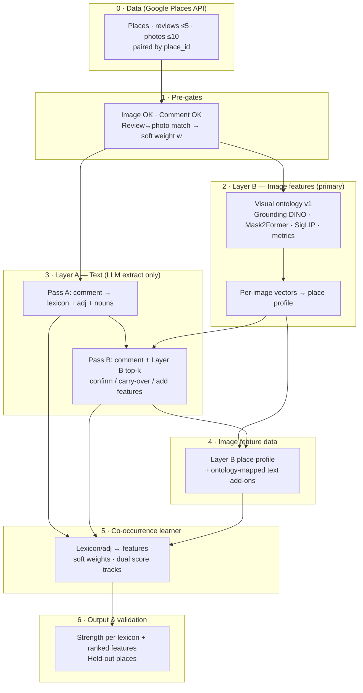
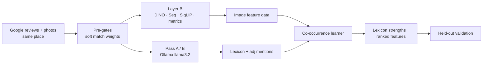
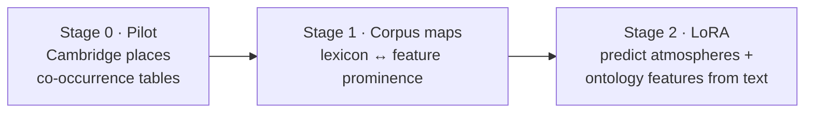
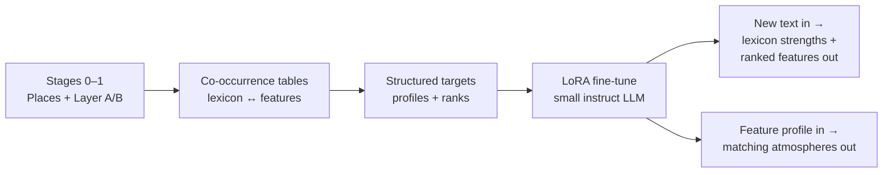
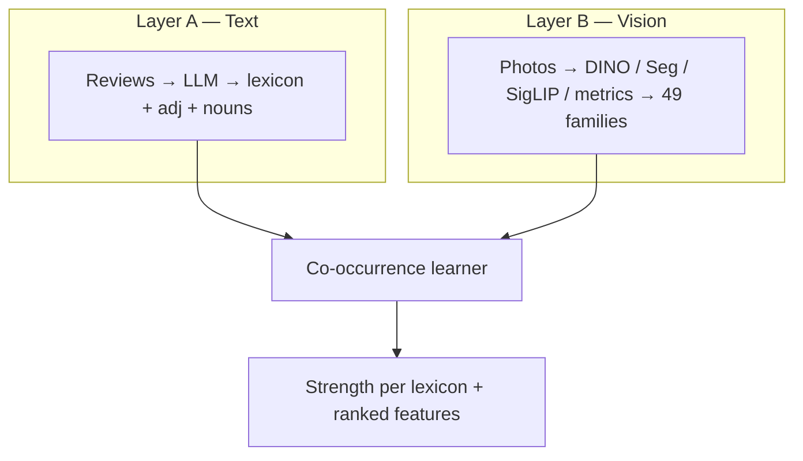

# High-architecture flowcharts

Mermaid diagrams for slides. GitHub renders these automatically when viewing this file on github.com.

---

## Full pipeline (recommended for architecture slide)

**Slide legend (optional footer):** LLM = extract only · Learner = scientific association · Not caption-level grounding

---

## Compact one-slide version

---

## Research stages (pilot → LoRA)

---

## Final goal — LoRA distillation

---

## Two layers (conceptual)

