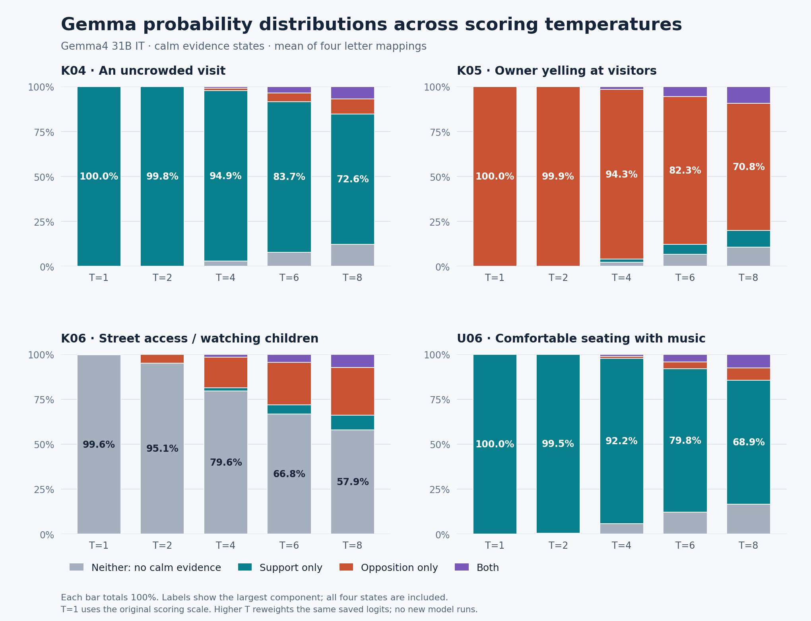
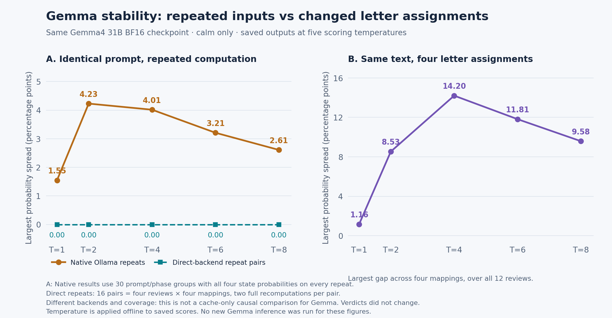
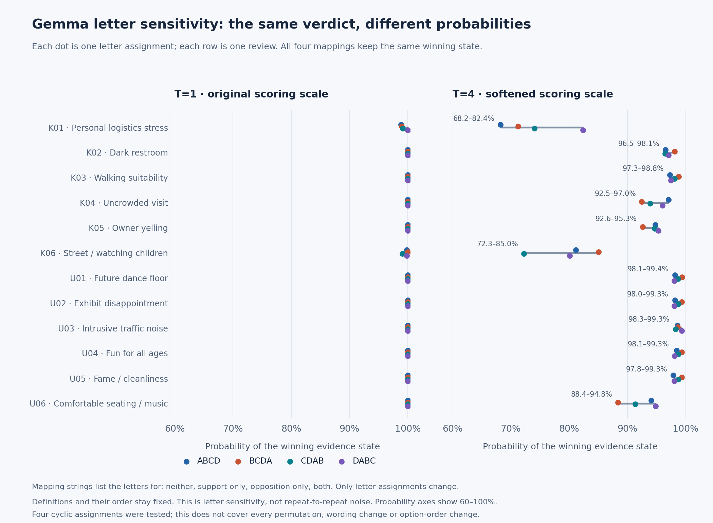
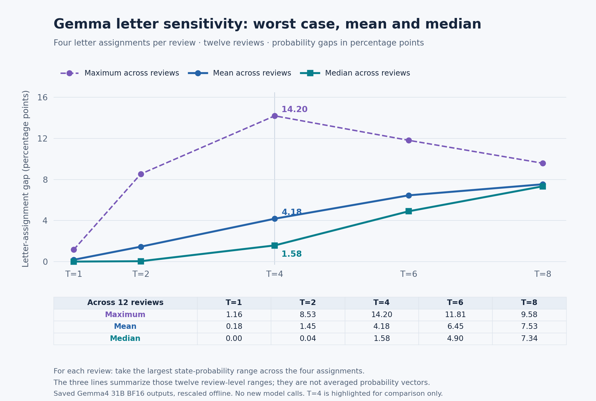

# Gemma probability audit, temperature, stability and aggregation — November 24, 2026

This records the discussion following the November 23 probability experiments, including corrections to the initial interpretation, the requested assistant audit, the researcher's response, and the figures explained during the session. All November 24 analysis reused saved outputs; **no additional Qwen or Gemma inference or GPU lease was used**.

## Models, task and source experiments

| Role | Exact tested Ollama tag | Recorded precision |
|---|---|---|
| Qwen | `qwen3.8:27b` | 27B, Q4_K_M |
| Gemma | `gemma4:31b-it-bf16` | 31B instruction-tuned, BF16 |

The [November 23 report](../research_audit/stage1a_probability_formats_12_2026-11-23/README.md) and [preceding repeatability/logit experiment](../research_audit/stage1a_probability_repeatability_12_2026-11-23/README.md) contain checkpoint digests, runtime details and raw evidence. The study uses **the same twelve real review targets, calm only**. The target supplies evidence; full-review context may resolve attribution and scope but cannot contribute a separate target claim. These twelve targets and three pilot emotions are development material, not the scope of the overall project.

The companion probability task has four **directional-evidence states**: neither, support only, opposition only, and both. These are not four different emotions, and neither is not a statement that the place has a neutral atmosphere. Probabilities come from the model's code-token scores, rather than generated numerical confidence statements.

## What the Qwen alternatives established

Code assignment and definition position were tested separately. An assignment change keeps meanings in their positions and changes the codes attached to them. A position change moves complete code/definition options while preserving their associations. Semantic answers remove arbitrary codes but retain fixed measurable response words: `none/support/opposition/both`.

| Qwen format | Median code-assignment gap | Median definition-order gap | Largest definition-order gap |
|---|---:|---:|---:|
| Letters | 14.34 pp | 16.36 pp | 40.53 pp |
| Numbers | 7.70 pp | 17.67 pp | 48.14 pp |
| Semantic words | Not applicable | 6.29 pp | 39.94 pp |

Numbers improve typical assignment robustness; semantic words improve typical order robustness. Large residual effects and occasional changed verdicts remain. Identical probabilities across repeated controlled inputs do not remove presentation sensitivity. The tested families use four cyclic variants, not every permutation or all assignment/order interactions. The existing executed report preserves the complete design, results and limitations; these conditions were not rerun on November 24. Gemma was not newly tested on numeric or semantic answer formats in this follow-up.

## Gemma: extracting, reversing and softening are different operations

All four capped state logits were captured through the direct backend. The recorded final soft-cap, with constant 30, could be inverted for all four codes in all 64 direct readouts. This reconstructs from finite-precision capped values; it is not a direct internal pre-cap tensor capture. **Undoing the cap sharpened the probabilities or left them numerically saturated. It did not explain the extreme values as something that could be removed by reversing the cap.**

Temperature softening also succeeded mathematically. It divides the saved logits by a positive scoring temperature and recomputes their four-state softmax. The explored grid is T=1, 2, 4, 6, 8. This is offline processing of saved outputs, separate from the fixed generation temperature of zero used for measurement.

Positive temperature scaling preserves each individual vector's state ordering and winner. An unchanged verdict after this transformation is expected mathematically; it does not constitute another independent stability test. Scaling adds no new textual evidence and does not fix attribution errors.

## Why T=4 appeared in the discussion

T=4 was an illustrative middle value in the explored grid. It exposes differences compressed near 100%, without flattening as much as T=6/8. **It was not optimized, selected by a formal performance criterion, or established as the correct temperature for this project.**

Increasing temperature produces softer distributions. It can initially make previously tiny alternatives easier to inspect, but it does not continuously increase distinctiveness: at very large T, all four states approach 25%. The temperature does not recover an unknown true emotional intensity or a uniquely correct probability distribution.

| Intended use | What would justify the choice |
|---|---|
| Exploratory inspection | Keep T=1 visible, report the temperature grid and describe transformed model preferences |
| Calibrated confidence in a verdict | Fit T on separate, trusted adjudicated examples and evaluate on other examples |
| Soft targets for later training | Treat T as a hyperparameter and compare downstream validation performance with hard targets and fixed smoothing |

Temperature scaling has established calibration and distillation precedents, but neither establishes T=4 or validates the project's weakly paired cross-modal training scheme. The primary sources are listed below.

## The first usefulness check: what it actually compared

The [initial numeric addendum](../research_audit/stage1a_probability_formats_12_2026-11-23/GEMMA_SIGNAL_EVALUATION.md) compared Gemma's softened vectors with inherited **reference verdict labels**, not probabilities from a previous Gemma run. It also compared them with fixed uniform smoothing around the same chosen verdicts, matched to the mean winning probability.

The source was the `reference` field in the November 16 `claims_by_emotion.json`. The code constructs that field from the earlier [target reference table](../research_audit/stage1a_stage2_context_live_2026-11-13/TARGET_SEGMENT_REFERENCE_AND_PREDICTIONS.csv), the v0.1 runner's `LATEST_BLIND` list, and the v0.5 runner's `AUDIT` overrides. The model-generated `claims_direction` field and the separate Qwen/Gemma prediction columns are different fields. The records describe researcher-provisional judgments plus user adjudications; complete authorship/approval for every inherited entry is not established.

Only K01 calm and U06 calm appear in the v0.5 explicit `AUDIT` override dictionary. This is a fact about that dictionary, not a claim that only two judgments were ever reviewed by the researcher. K03 and U01 are neither in the older table but opposition in the inherited reference, materially changing the apparent errors.

- NLL penalizes assigning little probability to the reference answer, especially confident disagreement.
- Brier measures squared differences between the entire predicted vector and the reference-label encoding.
- Error-ranking AUROC asks whether reference disagreements receive lower winning probabilities.
- The 100% value in a one-hot reference encoding means “this is the reference label”; it is not a previously measured human probability.

Reference agreement remained **9/12 at every temperature**. NLL/Brier can change without any verdict changing because the probability assigned to the reference state changes. At T=4, NLL was 1.012 versus 1.011 for fixed smoothing, Brier 0.432 versus 0.463, and error-ranking AUROC 0.556. Leaving out K01 reversed the Brier advantage. These figures are exploratory agreement/loss calculations against a partly disputed working key, **not independently verified accuracy, calibrated confidence, or a definitive verdict about probability usefulness**.

## The requested audit: current assistant reading, with researcher review

The researcher clarified that the intended audit was for the current advanced LLM to read the text and judge whether the probability pattern makes sense, bringing controversial cases to the researcher. The [qualitative assistant audit](../research_audit/stage1a_probability_formats_12_2026-11-23/GEMMA_QUALITATIVE_AUDIT_2026-11-24.md) therefore reviewed every target, full context, the actual fixed-choice prompt and the v0.5 codebook. Old references were not treated as truth for this reading. It was not blind: the assistant had already seen the earlier labels and scores.

The assistant found seven distributions qualitatively reasonable, one clear attribution mismatch (K01's personal logistical stress), and four cases to discuss with the researcher. K03's walking-suitability target and U01's future dance-floor target plausibly warrant neither; they should not automatically be counted as errors because an inherited key says opposition.

| Discussed case | T=4 preference | Assistant reading presented |
|---|---|---|
| K04: positively appraised uncrowding | Support 94.9%; neither 2.9% | Support by inference is plausible, while uncrowding does not necessarily establish calm |
| K05: owner yelling/accusing visitors | Opposition 94.3%; neither 2.2% | Opposition is plausible through an agitating confrontation; calm versus hostility remains a construct boundary |
| K06: parental vigilance beside a street | Neither 79.6%; opposition 17.1% | Primarily safety evidence, with vigilance plausibly reducing ease; the split is qualitatively sensible |
| U06: pleasant comfortable seating with music | Support 92.2%; neither 5.7% | Support by inference is plausible, while comfort and music need not imply tranquility |

The researcher replied, **“i actually agree with those cases.”** This records general agreement with the four presented case assessments. It is not a set of separately elicited replacement probability distributions, proof of the exact percentages, or a new blinded benchmark. The audit's follow-up record preserves this group agreement without fabricating individually supplied numerical judgments.

K01 remains informative as a failure: T=4 gives opposition 74.0% and neither 19.9%, while explicit intrusive traffic noise receives 98.7% opposition. The probability distinguishes the two cases coarsely, but the leading K01 interpretation is still an attribution error. At higher temperatures, unsupported alternative states also gain mass, so a more spread-out vector is not automatically a more sensible one.

## Probability distributions across temperature

Each bar below totals 100%. Distributions are calculated per mapping and then arithmetically averaged over the four mappings. Numbers inside bars mark the largest component; rounded 100.0% labels do not imply exact certainty.



[All twelve cases across temperatures](../research_audit/stage1a_probability_formats_12_2026-11-23/figures/Gemma_temperature_all_12_cases.png) · [Full-precision mean probability vectors](../research_audit/stage1a_probability_formats_12_2026-11-23/Gemma_probability_distributions.csv)

## Stability figure A: identical inputs, repeated computation

The first stability figure separates two questions. **A** repeats the exact same input and letter assignment, measuring the largest observed probability range across repeats.

- **Orange:** original native Ollama repeats. The softened comparison uses 30 prompt/phase groups with all four state scores available on every repeat. The native study had ten main repeats and three after reload per input; 624 Gemma readouts in total.
- **Teal:** a separate llama-cpp-python direct backend using the same Gemma GGUF, resetting state, clearing the KV cache and recomputing the entire prompt. Sixteen repeat pairs cover four reviews (K01, K06, U03, U06) under four assignments, with two full evaluations per pair. The captured four-code logits and resulting probabilities match exactly in those pairs.

**These backends/settings and their repeat coverage differ. This was not a Gemma cache-only causal comparison and does not establish that native Ollama became deterministic through a tested cache switch.** The separate Qwen cache control did test that question within its bundled backend.

At T=1, the largest native repeat spread was 1.55 percentage points. On the complete-score groups it becomes 4.01 points at T=4. Direct repeat-pair differences remain zero across the temperature grid. This is observed repeatability in specific tested setups, not proof that Gemma is intrinsically invariant in every environment.

## Stability figure B: letter-assignment sensitivity

**B** keeps the review, definitions and order of meanings fixed, while changing which letter represents each state. Four balanced cyclic assignments were tested:

| State | ABCD | BCDA | CDAB | DABC |
|---|---|---|---|---|
| Neither | A | B | C | D |
| Support only | B | C | D | A |
| Opposition only | C | D | A | B |
| Both | D | A | B | C |

For each review and temperature, find the largest state-probability range across those four assignments. B then reports the **maximum of those twelve review-level gaps**. It is neither a mean nor the highest probability value. It is also not a change in definition order. All 24 permutations, alternative wording and Gemma numeric/semantic formats are outside this test.

At T=4, K01's opposition probability ranges from 68.2% to 82.4%, giving the largest 14.20-point gap. K06's neither probability ranges from 72.3% to 85.0%. Verdicts remain unchanged under the tested Gemma assignments; their probabilities can nevertheless depend on the codes.





## Mean versus median: two different operations

**Combining permutation predictions:** use the arithmetic mean of the four full probability vectors after translating codes back to the same semantic state order. This is already how the temperature-distribution figures and exported mapping averages are calculated. Average the probabilities at the chosen T, rather than averaging letters or substituting the softmax of mean logits.

```text
combined_probability[state] = sum(probability_for_mapping[state]) / 4
```

The resulting vector still sums to 100%. Component-wise medians are a different robust aggregation rule and need not sum to 100%; choosing such a rule would require normalization and its own evaluation. The plotted lower median sensitivity does not establish that median prediction aggregation is better.

**Summarizing sensitivity:** first compute a gap for each review across its four mappings. Then report the median across twelve review-level gaps to describe a typical review, the maximum for the worst observed case, and optionally the mean for the average gap. Averaging predictions and averaging gaps are different quantities.

| Across twelve review-level gaps (pp) | T=1 | T=2 | T=4 | T=6 | T=8 |
|---|---:|---:|---:|---:|---:|
| Maximum | 1.16 | 8.53 | 14.20 | 11.81 | 9.58 |
| Mean | 0.18 | 1.45 | 4.18 | 6.45 | 7.53 |
| Median | 0.00 | 0.04 | 1.58 | 4.90 | 7.34 |

The tiny T=1 median rounds to 0.00; it is not the exact-zero direct-repeat result. At T=4, a few sensitive cases pull the mean above the median. As T rises through the explored grid, typical letter sensitivity increases even while the worst-case curve declines after T=4. A smaller summary statistic does not make the underlying predictions more stable.



[Full-precision stability summaries](../research_audit/stage1a_probability_formats_12_2026-11-23/Gemma_stability_summary.csv) · [Per-mapping probability vectors](../research_audit/stage1a_probability_formats_12_2026-11-23/Gemma_mapping_probabilities_by_temperature.csv)

## Current working decisions and remaining scope

- Preserve the full logits, original scoring scale, temperature grid and mapping ranges. Missing top-k alternatives must not be filled with zero before softening.
- Use semantic-aligned arithmetic probability means as the current combined representation for comparison. Report median and maximum review-level sensitivity, with the mean available alongside them.
- Treat T=4 as a diagnostic view, not a fixed calibrated or training temperature. No final probability-weighting or supervision scheme has been adopted.
- The requested audit is a qualitative assistant reading with researcher review of disputed cases. Keep its judgments and the researcher's group agreement distinct from the historical reference-based calculations.
- Calibration, stable numeric interpretation across new prompts, and better image-model learning remain separate empirical questions. This pilot does not establish an emotion-intensity scale or downstream training benefit. The embedding and NLI directions previously agreed in the wider discussion were not reopened by this follow-up.

The chart data are derived from the already archived experiments. [Plot regeneration code](../research_audit/stage1a_probability_formats_12_2026-11-23/plot_gemma_followup.py) recreates the plotted quantities from the committed CSV exports, without model inference. The original report and raw archives remain available and unchanged.

## Primary methodology precedents discussed

- [Guo et al., 2017 — On Calibration of Modern Neural Networks](https://proceedings.mlr.press/v70/guo17a.html): scalar temperature scaling, fitting against a held-out validation set, unchanged predicted class, and the high-temperature uniform limit.
- [Hinton, Vinyals and Dean, 2015 — Distilling the Knowledge in a Neural Network](https://arxiv.org/abs/1503.02531): higher-temperature soft targets, arithmetic/geometric averaging of teacher distributions, and empirical dependence on temperature and student capacity. This is precedent for candidate training targets, not validation of the weak location-paired project as a whole.
