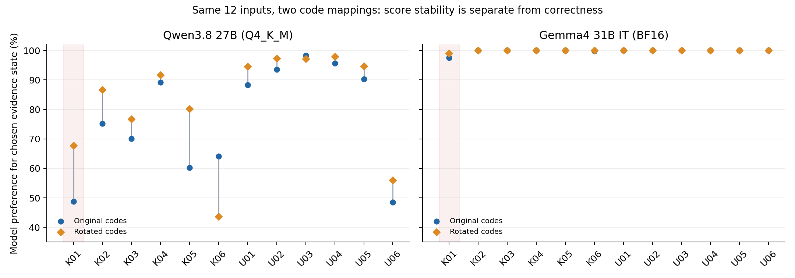

# Model probability stability, stabilization and logits — November 23, 2026

**Executed follow-up:** [Same-checkpoint repeatability, cache control and direct logits](../research_audit/stage1a_probability_repeatability_12_2026-11-23/README.md) now tests these proposals with ten main repetitions plus three after reload, four letter mappings, 240 supplementary cache calls and 64 Gemma direct passes. The original-pilot caveat below describes the earlier experiment; the new report provides the missing repeat baseline.

**Status: literature-informed discussion remark.** This records the follow-up to the [calm probability pilot](../research_audit/stage1a_calm_probability_12_2026-11-23/README.md) and the [three-point probability/embedding/NLI remark](research-discussion-2026-11-19.md#9-november-23-follow-up). The stabilization methods and acceptance criterion below are proposals. No additional model inference, backend migration, calibration, model selection or training was executed for this follow-up.

## How the question developed

The researcher asked whether the probability readout behaved normally, whether question wording could matter, whether Gemma should be preferred because Qwen's probabilities moved more, and whether the movement might simply reflect repeated-run variability. The last distinction is essential: the original discussion attributed the numerical difference to letter reassignment too strongly before checking identical-request repeatability.

The experiment used the same 12 real target segments/full reviews, a fixed codebook, one emotion (calm), and these mappings:

| Evidence state | Original code | Rotated code |
|---|---|---|
| Neither supporting nor opposing evidence | A | B |
| Supporting evidence only | B | C |
| Opposing evidence only | C | D |
| Both supporting and opposing evidence | D | A |

The semantic option order was preserved. Only letter assignments changed; question wording was not tested. Each mapping was run once per case/model. Both models retained their chosen state on all 12 cases. The largest observed semantic-state probability difference was **23.26 percentage points for Qwen** and **1.50 points for Gemma**. Gemma assigned at least 99.9% to its chosen state in 21/24 readouts.

**Corrected interpretation:** these are observed between-mapping differences. They suggest answer-code sensitivity, but the experiment does not isolate that effect from within-identical-request variability. Nor does Gemma's smaller movement on the probability axis establish greater underlying stability: softmax suppresses absolute probability variation near 0 and 1. This is supported as a general mechanism by the token-level nondeterminism study [1], not established as the cause of our particular comparison.



The chart displays the chosen state's probability conditional on the four response codes, rather than emotional intensity or a human-validated probability of correctness. Gemma entries with omitted alternatives use the pilot's conservative, tightly bounded estimates. A stable categorical decision and a stable probability vector are different properties.

## 1. Are our models trustworthy for reproduction?

**Both remain usable research candidates; reproducibility of their native probability measurements is not yet verified in our exact setup.**

The earlier [v0.5 experiment](../research_audit/stage1a_v05_directional_live_2026-11-16/README.md) repeated each model three times and retained the same 36/36 emotion–direction combinations. That metric concerns directional claim presence, not identical reasoning, complete claim semantics or native probability values. The later probability pilot did not include repeated identical readout requests.

Reproducibility is a property of the model **and** its inference implementation, hardware, precision, tokenizer/template, batching and cache behavior. A fixed seed and temperature zero control sampling but do not guarantee identical computation. Thinking Machines demonstrates this distinction and a concrete numerical remedy [2]. The reviewed studies do not certify our exact Qwen3.8 27B and Gemma4 31B checkpoints on Ollama 0.40.17.

Our checkpoint comparison also mixes **Qwen Q4_K_M** and **Gemma BF16**. Precision is a comparison confound, not proof that quantization caused the observed variation. Exact digests, requests and runtime metadata are preserved in the pilot archive.

The literature supports separating:

- **Repeatability:** repeated measurements under the same specified conditions.
- **Robustness across controlled changes:** label mappings, equivalent wording or other prespecified changes.
- **Validity/calibration:** whether the judgment and numerical preference are appropriate for the task.

The JAMIA framework separately measures response meaning and token-generation certainty under identical and changed conditions [3]. Its internal metric summarizes entropy-derived certainty; it is not a substitute for comparing every component of our four-state vector.

## 2. Can we stabilize them?

**Yes. Stabilize computation and semantic readout separately.**

### A. Control identical-request computation first

Freeze model files/digests, tokenizer and chat template, software versions, GPU/driver, precision and attention implementation. Keep requests sequential on one GPU and explicitly set `OLLAMA_NUM_PARALLEL=1`. Keep batching and cache behavior fixed; check cold-cache and warm-cache requests separately. The llama.cpp server documents that prompt caching can expose different numerics between prompt processing and token generation [4]. Temperature zero and seed 42 are already used in our pilot, so setting them again would not constitute an additional stabilization method.

These controls reduce possible variation; they are not a guarantee of bitwise identity. A dedicated GPU alone is not such a guarantee either.

**A stronger validated route is batch-invariant kernels.** Thinking Machines reported 80 distinct completions among 1,000 temperature-zero requests before its intervention, and 1,000 identical completions after introducing batch-invariant computation [2]. This was a different Qwen checkpoint and workload, not a guarantee for ours.

Current vLLM provides `VLLM_BATCH_INVARIANT=1` [5]. It is a beta feature, belongs to a separate inference backend, and requires checking compatibility with our exact models and precision. vLLM limits its reproducibility assurance to the same hardware and software version [6]. Moving to another backend must be logged as a new experimental condition, not silently substituted for the original Ollama run.

### B. Reduce dependence on one letter mapping

Run four balanced cyclic mappings so each state occupies every letter once, map results back to their semantic states, and average the probability vectors. Retain the across-mapping spread alongside the average. This costs four readouts per input rather than one.

Permutation averaging has published methodological precedent [7]. Four cyclic mappings are an approximation to all 24 assignments of four labels: they reduce reliance on a chosen mapping but do not remove every possible letter interaction or wording effect. Our proposed letter-only implementation also preserves semantic option order, whereas much of the precedent permutes displayed options. That adaptation requires validation.

For Gemma, a full-vector average needs all four candidate scores or explicit missing-score bounds; missing top-20 alternatives must not be set to zero.

### C. Test wording and examples separately

Equivalent questions can shift model probabilities without changing their intended meaning. Changes such as “plausible evidence” versus “only clearly demonstrated evidence” may instead change the acceptance threshold. Asking whether the place is calm differs from asking whether this target supplies place-attributed calm evidence. Keep the construct, evidence rules and task fixed when testing paraphrases.

POSIX found that fixed few-shot demonstrations often reduced prompt sensitivity in its tested models [8]. Our codebook already includes examples; adding more is not automatically a remedy. Evaluation cases must remain separate from prompt examples.

Temperature scaling may soften Gemma's saturated probabilities and can be fitted against held-out labels. It does not make inference deterministic, remove label bias by itself or establish emotional intensity. Prefer a measured correction over changing temperature merely to obtain a wider-looking chart.

## 3. What probability fluctuation range is acceptable?

**There is no universal literature-backed “±X% is acceptable” cutoff.** The token-level study reports ranges and standard deviations over repeated runs; its observed variation is not an acceptance standard for our training targets [1]. Its aggregate statistics include many near-zero alternatives, so they should not be treated as the expected range of our decision probabilities.

For an initial diagnostic, the assistant proposed **at most 1 percentage point peak-to-peak per state across 50 identical requests**, with decision flips investigated separately. **This is a proposed project tolerance, not a published standard, adopted project rule or completed test.** An observed range over 50 runs also cannot bound every future request.

Record each semantic state's probability distribution across repeats, its standard deviation/range, full-vector differences and decision changes. Inspect logit margins as well, because near-0/1 saturation can conceal score movement. Changes between mappings or equivalent wordings require their own analysis; do not combine them with identical-request noise into one statistic.

Final acceptance should depend on whether remaining variation materially changes segment rankings, emotion representations, training weights or downstream results. Stability and semantic validity must be evaluated separately: a consistent error is still an error.

## 4. Can we obtain pre-softmax values?

**Yes: these are logits. The standard Ollama 0.40.17 API exposes log probabilities, not a raw-logit field.** This was checked against that release's API types/routes and runner implementation, as well as the API documentation [9].

| Route | What is accessible | Practical qualification |
|---|---|---|
| Direct llama.cpp | `llama_get_logits_ith()` retrieves vocabulary logits [10] | Can retain our existing GGUF files; pin implementation and rendering to preserve the comparison. |
| Direct Transformers forward pass | `outputs.logits` contains scores before softmax [11] | Pin the exact checkpoint representation and tokenizer/template. Switching from our quantized GGUF to original BF16 weights is a new condition. |
| Existing saved native log probabilities | Relative logit differences for returned candidates | Does not recover absolute logits; omitted alternatives still limit coverage. |

For the same unmodified softmax distribution at the same token position:

```text
z_i - z_j = log(p_i) - log(p_j)
```

The common softmax normalization cancels. Absolute logits are identifiable only up to a shared additive constant from probabilities alone. If sampling temperature or other score transformations are applied to the measured distribution, their effects must also be accounted for.

Gemma's standard returned logits are **after final-logit soft-capping but before softmax**. Capturing values before soft-capping requires an additional hook into the language-model head; the model's Transformers implementation explicitly applies that operation [12]. For comparing decisions, relative post-soft-capping margins are already useful. Neither raw logits nor margins are automatically calibrated confidence or directly comparable across different model families.

### What the existing chart does

The pilot saves native token log probabilities, converts them using `p = exp(log_probability)`, and normalizes over A/B/C/D for the four-state readout. It does not apply softmax a second time to probability values. Across the saved Gemma readouts, that renormalization changes the chosen-state probability by at most **0.0035 percentage points**; the near-100% concentration is already present in the native output. These values can be recomputed from the archived `analysis_details.json`.

## Proposed next diagnostic, not an executed experiment

First measure identical-request repeatability for each exact model on the fixed real inputs, including cold/warm cache conditions and reload checks. Then compare balanced letter mappings and equivalent question wordings against that baseline. Log the full four-state probabilities and relative logits, preserve all requests/settings, and assess semantic judgments separately. The 50-repeat suggestion, backend comparison and averaging method remain proposals; no additional compute run is reported as executed.

## Primary references and checked implementation sources

1. Fu et al., **Beyond Reproducibility: Token Probabilities Expose Large Language Model Nondeterminism**, IEEE Transactions on Computers, 2026; [open manuscript](https://arxiv.org/html/2601.06118), [publication DOI](https://doi.org/10.1109/TC.2026.3732142). Studies 50 runs and compares probabilities only while preceding token contexts remain identical; models/GPUs/batches differ from our exact pilot.
2. Thinking Machines Lab, **Defeating Nondeterminism in LLM Inference**, September 10, 2025; [primary engineering study](https://thinkingmachines.ai/blog/defeating-nondeterminism-in-llm-inference/). This is a technical research report with code/experiments, not a peer-reviewed model-specific guarantee.
3. **A statistical framework for evaluating the repeatability and reproducibility of large language models**, JAMIA, published November 5, 2026; [article](https://doi.org/10.1093/jamia/ocag186). Distinguishes identical-condition repeats, prespecified changes, response meaning and entropy-derived token certainty.
4. llama.cpp, [server documentation](https://github.com/ggml-org/llama.cpp/blob/master/tools/server/README.md), especially `cache_prompt`, native log probabilities and post-sampling probability modes.
5. vLLM, [batch invariance documentation](https://docs.vllm.ai/en/stable/features/batch_invariance/).
6. vLLM, [reproducibility documentation](https://docs.vllm.ai/en/stable/usage/reproducibility/).
7. Liusie, Fathullah and Gales, **Teacher-Student Training for Debiasing: General Permutation Debiasing for Large Language Models**, ACL Findings, 2024; [paper](https://aclanthology.org/2024.findings-acl.81/), Section 3.2. Full-permutation averaging and cyclic approximations. Related mechanism study: Yang, Jian and Li, **Option Symbol Matters**, NAACL, 2025; [paper](https://aclanthology.org/2025.naacl-long.95/). The symbol study changes symbol sets; it is close precedent rather than an exact reproduction of our letter reassignment.
8. Chatterjee et al., **POSIX: A Prompt Sensitivity Index For Large Language Models**, EMNLP Findings, 2024; [paper](https://aclanthology.org/2024.findings-emnlp.852/). Measures response log-likelihood variation under intent-preserving prompts; Section 5.4 examines few-shot examples.
9. Ollama, [chat API](https://docs.ollama.com/api/chat), [v0.40.17 API types](https://github.com/ollama/ollama/blob/v0.40.17/api/types.go), [routes](https://github.com/ollama/ollama/blob/v0.40.17/server/routes.go), [runner](https://github.com/ollama/ollama/blob/v0.40.17/llm/llama_server.go), and [concurrency settings](https://docs.ollama.com/faq#how-does-ollama-handle-concurrent-requests).
10. llama.cpp, [C API header](https://github.com/ggml-org/llama.cpp/blob/master/include/llama.h), `llama_get_logits_ith`.
11. Hugging Face Transformers, [model output documentation](https://huggingface.co/docs/transformers/main_classes/output), `CausalLMOutputWithPast.logits`.
12. Hugging Face Transformers, [Gemma4 implementation](https://github.com/huggingface/transformers/blob/main/src/transformers/models/gemma4/modeling_gemma4.py), language-model head and `final_logit_softcapping`.

External documentation was checked November 23, 2026. Unversioned upstream links can change. Published component findings support these candidates; they do not validate the exact combined pipeline or a numerical acceptance threshold for this project.


## Executed diagnostic: new evidence

The [new report](../research_audit/stage1a_probability_repeatability_12_2026-11-23/README.md) separates mapping sensitivity from repeat variation. Qwen's native main-phase mapping-mean spread reached 22.93 percentage points against a 3.66-point identical-request range. Controlled full recomputation removed observed repeat variation on twelve selected prompts yet retained a 24.78-point mapping spread. A letter effect is confirmed in this setup, independently of the observed cache-related variation; the training mechanism behind the letter preference was not isolated.

Gemma's corresponding main-phase values were 1.21 points between mapping means and 1.55 within identical requests, while saturation concealed logit-margin movement. Direct capped logits from the same BF16 GGUF agreed with all 64 native chosen states and verified c=30 metadata. Analytic inversion was valid for the four code scores in all 64 passes, and removing the cap never softened the winning probability. This is a finite-precision reconstruction, not an internal pre-cap hook; probabilities alone still cannot uniquely recover absolute pre-cap scores.

The report records API/backend distinctions, missing-alternative bounds and legacy raw-field caveats, backend alignment, temperature sensitivity, source-byte recovery, raw artifacts and verified pod termination. Calibration and downstream usefulness remain separate experiments.
