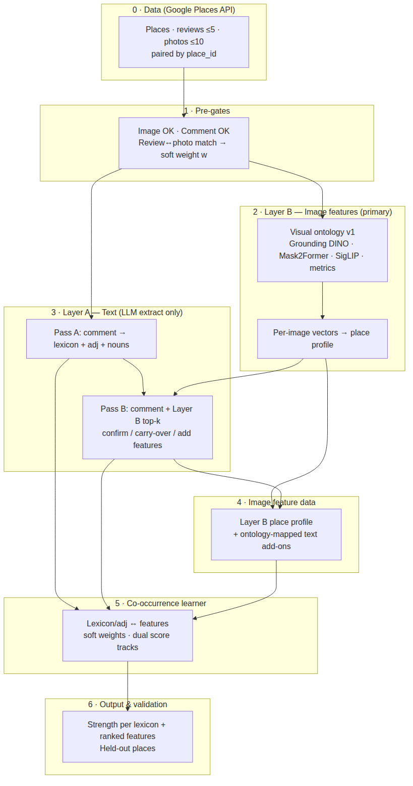
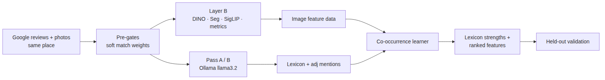
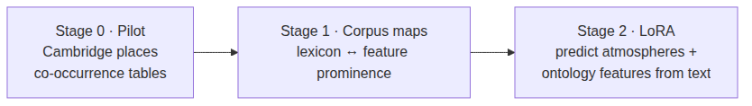
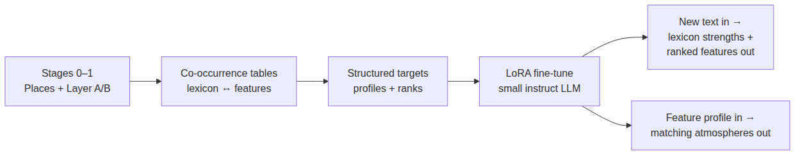

# Presentation — Atmosphere Grounding Research Brief

Slide-ready text from design sessions (August 2026).

---

## Slide 1 — Project intro (3 sentences)

People describe public spaces with atmosphere words—*inviting*, *safe*, *calm*—but we rarely know **which visible structure** in a place supports those feelings. **Atmosphere Grounding** links Google place reviews and photos through a shared location, learns which measured visual features co-occur with atmosphere language in *our* corpus, and surfaces those links as inspectable evidence—not as a generic vision model’s guess. The long-term aim is practical: from a passage of text, show how strongly each atmosphere lexicon applies and which image features rank as support—grounded in data, not invented by an LLM.

---

## Slide 2 — Project goal (~3 sentences)

**Goal:** From place-linked reviews and photos, learn **adj/lexicon ↔ image-feature** associations by **co-occurrence** across places, then for new text or places output **strength per lexicon** (*inviting* / *safe* / *calm*) and **ranked supporting ontology features** under each. **Layer A** uses **Ollama (llama3.2)** to extract atmosphere language and map it to lexicons (Pass A: comment-only; Pass B: comment + **Layer B** profile); **Layer B** measures images with **Grounding DINO**, **Mask2Former**, **SigLIP**, and image metrics over a locked **49-family visual ontology**—the primary image signal, with text-side nouns as add-ons when photos miss what reviewers describe. A **weighted co-occurrence learner** (soft **SigLIP** review–photo match weights, place-level aggregation, dual corpus/local score tracks) produces the associations; validation uses **held-out places**, with optional shuffle-null tests—not human rating panels for the pilot.

---

## Slide 3 — What we are *not* doing (optional)

- Not text-to-image generation  
- Not LLM-invented adj ↔ feature links  
- Not hand-coded “calm = trees”  
- Not caption-level phrase→box grounding (reviews and photos are place-paired, not sentence-paired)

---

## Slide 4 — Final goal: LoRA (~3–4 sentences)

After the co-occurrence learner has built **corpus-grounded tables** linking lexicons (*inviting* / *safe* / *calm*) to **Layer B ontology features**, we fine-tune a small instruct LLM with **LoRA** so it can **predict atmosphere strengths and supporting image features from new text**—speaking in the same ontology vocabulary the pipeline measured, not free-form visual guesswork. **Training targets come from the learned association maps and measured place profiles** (structured JSON / templated text from co-occurrence score tracks), not from another LLM labeling photos; the statistical learner remains the scientific backbone, and LoRA is the **fluent interface** that distills what the project already learned. In practice: given a review-like passage, the tuned model outputs **how strong each lexicon is** and **which visual families rank as support**; given a feature profile, it can also describe **which atmospheres fit** our data. This closes the loop from **weakly paired Places data → interpretable co-occurrence → deployable text↔feature prediction**—still **not** text-to-image generation.

**One-liner title:** *Distill co-occurrence into an LLM: LoRA for lexicon strength + ontology feature prediction*

---

## Slide 5 — LoRA talking points (30 sec)

| Point | Message |
|-------|---------|
| Why LoRA | Cheap adapter on a small LLM; learns *our* mapping |
| Trains on | Measured Layer B features + co-occurrence tables |
| Predicts | Lexicon strengths + ranked ontology features (text → features; later features → atmospheres) |
| Not | Text-to-image; LLM inventing visuals from photos |
| When | After Stage 0–1 maps generalize on held-out places |

**Caveat:** LoRA quality tracks co-occurrence robustness—weak associations → fluent but unreliable narrator.

---

## Flowcharts

See [`flowcharts.md`](flowcharts.md) for Mermaid source. **PNG files for slides:**

