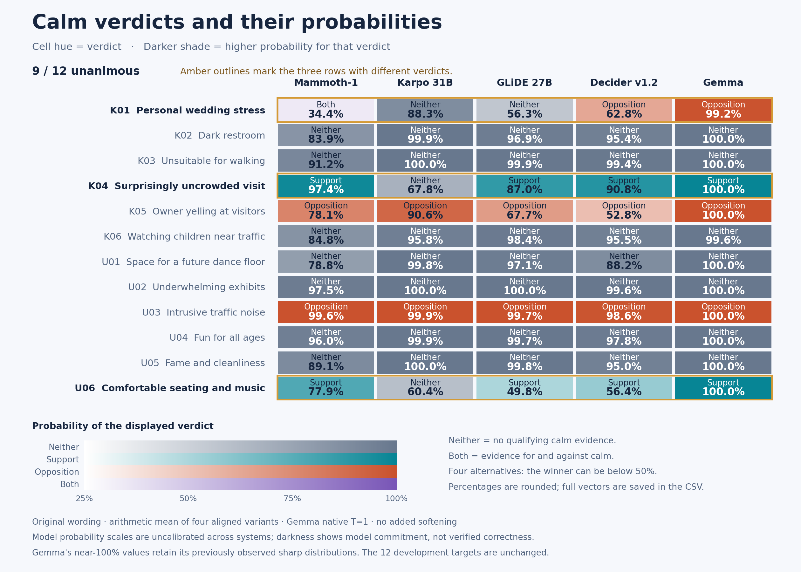
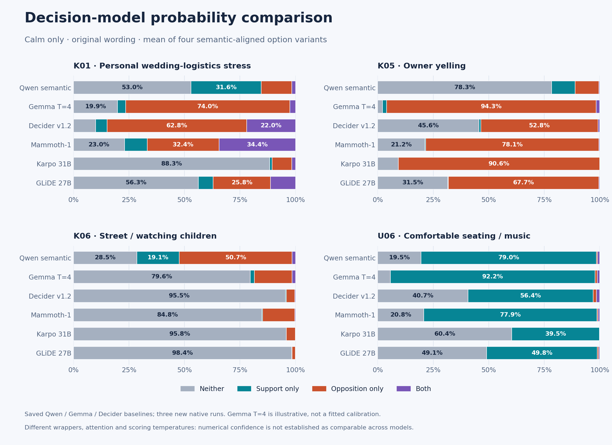

# Native decision-model comparison: Mammoth, Karpo and GLiDE

> **Temporary wrap, November 24:** all five graph models remain candidates: Mammoth-1, Karpo 31B, GLiDE 27B, PPLX-Decider v1.2 and Gemma4 31B BF16. Probability testing is paused; embeddings are next. [Consolidated findings, corrected candidate status and handoff](#temporary-probability-wrap-for-november-24-2026).

Discussion and completed experiment, November 24, 2026.

The earlier PPLX-Decider test established exact repeatability in its tested native path, direct access to raw option scores, and modest order sensitivity. Its twelve combined verdicts matched Gemma, including the known wedding-stress attribution error. That result motivated looking for a probability reader with both reproducible scores and faithful emotion attribution.

The researcher supplied six further candidates, initially requested evaluation only, and then selected the first three for testing. Mammoth-1 offered relevant public evidence on equivalent-question consistency, with the important caveat that abstention helped drive that result. Karpo offered a Gemma-family decision fine-tune; GLiDE offered another native decision approach. d3-ultra, Clef and hosted Drex were not tested here. The researcher also asked whether Ollama availability was required. It was not: all three selected models were executed with published weights and their native Python implementations on Runpod.

The [completed report](../research_audit/stage1a_three_decision_models_12_2026-11-24/README.md) contains the exact model/runtime pins, original inputs, raw evidence, three charts, full probability exports and case-level assistant audit.

## Graphics

### Verdicts across all five models

[Open the shaded verdict chart at full size](../research_audit/stage1a_three_decision_models_12_2026-11-24/five_model_verdict_probabilities.png) · [Vector graphic](../research_audit/stage1a_three_decision_models_12_2026-11-24/five_model_verdict_probabilities.svg) · [Complete probabilities and winner margins](../research_audit/stage1a_three_decision_models_12_2026-11-24/five_model_verdict_probabilities.csv) · [Target segments and categorical verdicts](../research_audit/stage1a_three_decision_models_12_2026-11-24/five_model_verdict_comparison.csv).

Color hue identifies the verdict; darker shades indicate a larger probability for that displayed state. Each cell also prints the winning probability. The color ramp mixes white at 25% with the verdict color at 100%; this is a visualization mapping only. The underlying saved probabilities are unchanged. Four alternatives mean a winning state may have less than 50% probability. The CSV retains all four states plus the runner-up and winning margin.

Gemma keeps its original native T=1 values, explaining its nearly saturated cells. All probabilities are arithmetic means of four aligned original-wording vectors. Cross-model probability scales have not been calibrated; shading displays each model's commitment among the four states, not measured correctness or emotion intensity. The earlier [categorical chart](../research_audit/stage1a_three_decision_models_12_2026-11-24/five_model_verdict_comparison.png) remains available.

All five models agree on **9 of 12** targets. Gemma and Decider agree on **12 of 12**. Karpo returns neither on the two inferred positives (uncrowding and comfortable seating/music), while the other four return support. For personal wedding stress, Mammoth returns both, Karpo and GLiDE return neither, and Decider and Gemma return opposition.

Each cell takes the highest-probability state after the arithmetic mean of four semantically aligned, original-wording vectors. Gemma uses the saved T=1 mapping mean; its T=4 mapping mean gives the same twelve verdicts. New models and Decider jointly vary criterion order and native codes; Gemma varies letter assignment at fixed definition order. These are saved-system comparisons, not a common controlled order manipulation or an accuracy ranking. Original-wording presentation flips for Mammoth K01 and GLiDE U06 are hidden by a single aggregate cell; the full distributions and sensitivity results remain below.

### Probability distributions

Original-wording probability profiles for the four audited cases, comparing the three new models with saved Qwen, Gemma and Decider results. Gemma T=4 is illustrative softening; cross-model confidence calibration is untested.

[Open the probability chart at full size](../research_audit/stage1a_three_decision_models_12_2026-11-24/four_case_probability_comparison.png).

### Order and wording sensitivity

Median and worst probability shifts across the twelve targets. The wording panel averages four aligned option-order vectors per wording; these shifts are separate from identical-input repeatability.

[Open the sensitivity chart at full size](../research_audit/stage1a_three_decision_models_12_2026-11-24/order_and_wording_sensitivity.png).

## Executed design

Same twelve real targets, unchanged full v0.5 codebook, calm only. For each model: 480 original-wording evaluations, 288 evaluations under two equivalent task-instruction paraphrases, and twelve canonical requests after unload/reload. The completed planned total is **2,340 decisions**. Original-wording requests match the saved Decider requests; the new wordings preserve the reviews, codebook and criterion definitions.

All three produced identical raw scores and analysis probability vectors across their repeated inputs and all reload checks. Four cyclic native option orders jointly change positions and internal codes, so these are not Gemma's old isolated letter-assignment conditions. Prediction aggregation remains the arithmetic mean of semantic-aligned probability vectors; median gaps summarize typical sensitivity across the twelve targets.

| Model | Median / worst original order gap | Worst wording gap after four-order averaging | Reading that matters |
|---|---|---|---|
| Mammoth-1 | 4.74 / 7.53 pp | 4.27 pp | Retains the personal-stress attribution error; its winning interpretation changes across presentations |
| Karpo 31B | 0.075 / 4.13 pp | 9.82 pp | Cleaner attribution and strict acceptance; rejects the two plausible positive T inferences as winners |
| GLiDE 27B | 0.62 / 4.14 pp | 6.22 pp | Retains the positive T inferences; seating/music is effectively a support/neither tie |

The mean winners remain unchanged across the three wordings for Karpo and GLiDE, but this does not erase individual presentation effects. Their seating/music case changes winner in some matched orders. Karpo's worst wording gap with order held fixed is **13.54 pp**. Mammoth's wedding target changes mean winner between both and opposition; the appropriate neither reading still receives only 23.00% in its original mean.

## Probability interpretation and case audit

For wedding logistics, Karpo assigns neither **88.33%**, GLiDE **56.28%**, and Mammoth **23.00%**. Mammoth allocates **66.81%** to states containing opposition; GLiDE retains **37.05%** there despite its appropriate winning state. A lower maximum probability or correct winner alone does not establish that the full soft vector is suitable for training. The separate gate can reject this review, so its correction is diagnostic rather than a measured production gain.

For uncrowding, Karpo assigns neither **67.79%** and support **32.11%**, while GLiDE assigns support **87.01%**. For comfortable seating/music, Karpo is neither **60.41%** versus support **39.51%**; GLiDE is support **49.83%** versus neither **49.05%**. This exposes the main project choice: how reliably the text scorer retains defensible T evidence. Prior general agreement on Gemma boundary cases is not a new human annotation of these models' probabilities.

Neither remains absence of qualifying evidence, not abstention. Both requires grounded claims in both directions and cannot be used as a general uncertainty bucket. Native probability scores remain model preferences among those configurations; task calibration, emotion intensity and downstream training usefulness were not established.

## Execution clarification and resource cleanup

The initial Mammoth harness stopped because its native API rounds probabilities to six decimals and the numerical check compared against unrounded values. The first attempt was retained, the check was corrected through the official formatter, and the unchanged full schedule was rerun. Raw logits, rounded native values and unrounded native softmax are all preserved. Karpo's full formatter was also verified offline. No model weights, temperatures, codebook definitions or review inputs were tuned in response to these results.

The complete archive and 165 manifest-listed files were verified before the owned GPU was terminated. Estimated compute was **$1.89** at **$2.69/hour**, below the agreed budget; a fresh post-termination pod list was empty.

**Current candidate decision, updated after the five-model graph discussion:** retain all five: Mammoth-1, Karpo 31B, GLiDE 27B, PPLX-Decider v1.2 and Gemma4 31B BF16. The earlier two-finalist assessment and firm last-place placement for Mammoth were premature. Keep the measured tradeoffs and attribution concerns, while also retaining Mammoth's useful positive T readings and its smaller worst wording effect. Probability work is temporarily paused; see the [wrap and embedding handoff](#temporary-probability-wrap-for-november-24-2026). No final model, calibrated probability interpretation or training-weight rule is adopted.

---

## Temporary probability wrap for November 24, 2026

**Researcher decision:** pause this probability side study and move next to the embedding tests. **Keep all five models in the comparison graph as candidates: Mammoth-1, Karpo 31B, GLiDE 27B, PPLX-Decider v1.2 and Gemma4 31B BF16.** No final ranking, production model, scoring temperature or probability-based training weight is selected. This updates the earlier two-finalist assessment; it does not replace or rerun the recorded experiments.

### What the signal means

The experiment measures one emotion at a time, using four defined evidence states: **neither / support only / opposition only / both**. Neither means no qualifying evidence for that emotion; both requires evidence in both directions. Neither is not emotional neutrality, and both is not a general uncertainty response. Reviews and full context establish scope and attribution; evidence for a decision must come from the target segment.

The retained values are probabilities derived from native model scores, not numbers generated by asking an LLM to rate its own confidence. They express model preference among the defined alternatives. Under the stated trust premise they are legitimate candidate soft signals; trusting a verdict does not by itself validate the numerical probabilities. They have not been established as emotion intensity, correctness probabilities on this task, or useful image-training weights. Decider's additional `confidence` field is only a transformation of its largest probability.

### What the tests established

| Question | Finding retained at this pause |
|---|---|
| Can identical requests reproduce their scores? | Yes in the tested controlled routes. Qwen full prompt recomputation produced identical probabilities across ten repeats for twelve prompts: **three targets × four letter assignments**. Gemma's sixteen direct full-recomputation repeat pairs matched exactly. Decider's 48 requests repeated ten times and twelve reload checks matched exactly. Mammoth, Karpo and GLiDE matched across their original-wording and added-wording repeats and all reload checks. These are configuration-specific results. |
| Are native Ollama and controlled direct runs interchangeable? | No. Earlier native Qwen and Gemma runs had within-payload probability variation even when verdicts stayed fixed. Qwen's controlled cache-on/off study isolates a cache effect in that backend; the Gemma direct/native comparison changes more than cache and is not a cache-only causal test. Fixed seed and generation temperature zero alone were insufficient. |
| Do answer codes and option positions matter? | Yes. Qwen's mapping effect survived deterministic recomputation. Numeric codes reduced median assignment spread from **14.34 to 7.70 pp**; semantic answers reduced median definition-order spread from **16.36 to 6.29 pp**. Large order effects remained: maxima **48.14 pp** for numbers and **39.94 pp** for semantic answers. Removing letters did not resolve presentation dependence. |
| Can we inspect Gemma before softmax? | All four capped state logits were captured. The finite-precision analytic soft-cap inverse worked on the captured scores, but removing the cap sharpened the distribution. Extraction and inversion succeeded; the proposed remedy for saturation did not. Log probabilities recover score differences, while probabilities alone do not identify absolute pre-cap logits. |
| Does temperature softening work? | Yes mathematically, using the complete saved score vectors. The grid **T=1, 2, 4, 6, 8** changes concentration without adding evidence. Each individual vector keeps its winner; this is not an independent stability result. T=4 is an illustrative view, not a fitted or adopted calibration. At T=4 Gemma's worst letter-assignment gap reached **14.20 pp**, revealing sensitivity compressed near 100% at T=1. |
| Do the probability patterns make semantic sense? | The requested current-assistant audit found seven qualitatively reasonable Gemma profiles, one clear personal-stress attribution mismatch, and four cases discussed with the researcher. The researcher's general agreement on those cases is recorded; exact probabilities were not human annotated. The earlier NLL/Brier calculations used an inherited, partly disputed working key and cannot establish independent accuracy or calibration. |
| Do softer outputs establish better probabilities? | No. More visible alternatives, a less extreme winner, exact repeats and a correct winning state answer different questions. Useful soft supervision beyond hard labels or fixed smoothing remains untested. No universal acceptable fluctuation range or project acceptance threshold has been established. |

The new three-model experiment completed **2,340 planned decisions** on the same twelve targets. Its original and corrected Mammoth formatter attempts, raw scores, actual call counts and cleanup records remain preserved in the [executed report](../research_audit/stage1a_three_decision_models_12_2026-11-24/README.md). No new independent review sample or broader emotion benchmark was created by repeats, paraphrases or this wrap-up.

### All five candidates stay open

| Candidate | Reason to retain | Concern still open |
|---|---|---|
| **Mammoth-1** | Retains both plausible positive calm inferences; exact controlled repeats; smaller worst wording gap after order averaging than the other two newly tested models. | Larger typical order effects and personal-wedding-stress attribution error. |
| **Karpo-decision-31B** | Strict evidence acceptance, low typical order sensitivity, and cleaner personal-stress attribution on this set. | Returns neither on both plausible positive T inferences; seating/music remains wording sensitive. |
| **GLiDE 27B** | Retains those positive inferences and chooses neither for personal wedding stress. | Seating/music is effectively tied: support **49.83%**, neither **49.05%**; individual presentations can change the verdict. |
| **PPLX-Decider v1.2** | Exact tested repeat/reload behavior, direct raw scores and less saturated native distributions. | Matches Gemma's twelve aggregate verdicts, including the attribution error; no matched new paraphrase study. |
| **Gemma4 31B BF16** (`gemma4:31b-it-bf16`) | Useful interpretation baseline and exact direct-backend repeat pairs; all saved four-mapping winners survived the explored temperature views. | Native probabilities are highly saturated; softening exposes mapping dependence and does not repair attribution. Native Ollama repeat behavior differs from the controlled direct pairs. |

**Correction to Mammoth's earlier placement:** the assistant initially emphasized its larger typical option-order effects and the attribution error. The subsequent five-model chart and discussion also recognized its retention of both plausible positives and its smaller worst wording effect. A firm last-place judgment exceeded these twelve-target results. Mammoth remains a candidate alongside the other four; Karpo and GLiDE are not an exclusive shortlist.

For the three newly tested systems, the native original-order gaps (median / maximum) are **Mammoth 4.74 / 7.53 pp**, **Karpo 0.075 / 4.13 pp**, and **GLiDE 0.62 / 4.14 pp**. Worst wording gaps after averaging four aligned order vectors are **4.27**, **9.82** and **6.22 pp**, respectively. Decider's native order gap is **1.07 / 6.90 pp**. Gemma's isolated letter-assignment manipulation and these native joint order/code manipulations are different factors; these figures do not establish an architecture-only ranking. Qwen remains a documented historical comparator, outside the five-candidate set requested here.

### What the existing graph shows

The [five-model verdict and probability graph](#verdicts-across-all-five-models) uses the same twelve calm targets. All five agree on **9/12** aggregate verdicts, and Gemma and Decider agree on **12/12**. The three differing rows are personal wedding stress, positively appraised uncrowding, and comfortable seating/music. Agreement is not accuracy. The set lacks an unambiguous explicitly worded positive-calm control and cannot settle broader recall or the project's treatment of all T evidence.

The researcher first requested a categorical verdict chart, then requested probability-dependent color strength. The existing shaded chart therefore keeps **hue for the verdict** and uses **darker color for a higher probability of that displayed state**, with percentages in each cell. Gemma retains its original T=1 values; the new systems use their supplied T=1 scores and Decider its publisher temperature. These scales are not calibrated to a common correctness meaning. The chart is a view of saved outputs, not a new model run. Complete four-state vectors and runner-up margins are in the [existing CSV](../research_audit/stage1a_three_decision_models_12_2026-11-24/five_model_verdict_probabilities.csv).

For combined predictions, use the **arithmetic mean of the four semantically aligned probability vectors** as the current reporting convention. The graph displays the largest component of that mean. The **median** summarizes typical sensitivity across twelve target-level gaps; it is not the adopted prediction-aggregation rule. Four cyclic variants are not all 24 permutations. A single aggregate cell can hide presentation-specific flips, so retain the per-variant distributions and ranges.

### Handoff to embeddings

The next side study concerns **segment representativeness within its original full review**, using both original texts in the same embedding space. The intended later use is differential segment weighting in aggregation/training. It is separate from scoring an LLM's generated verdict or interpreting the probability as emotion intensity.

The earlier agreement remains: make a small task-specific comparison of credible embedding models on real examples, select an adequate model and freeze it, without chasing an optimal model. Using the same encoder makes the space consistent but does not guarantee correct relative rankings. Validate representativeness; emotionally important minority segments should not automatically receive negligible weight. The similarity-to-weight transform and its training role remain open. No embedding model or test result is selected or claimed in this wrap-up.

The separate NLI direction also remains provisionally agreed: multi-label evidence-category vectors, small equivalent hypothesis families, and definitions aligned with the image catalogue. NLI category membership, target eligibility, segment representativeness and emotion-state probabilities remain distinct quantities. No NLI checkpoint, family or final catalogue is frozen here.

### Existing evidence to resume from

- [Original probability interpretation, embedding and NLI agreement](research-discussion-2026-11-19.md#9-november-23-follow-up).
- [Probability stability research and logits discussion](model-probability-stability-and-logits-2026-11-23.md).
- [Executed repeatability, Qwen cache control and Gemma logit/inverse study](../research_audit/stage1a_probability_repeatability_12_2026-11-23/README.md).
- [Executed Qwen code/position alternatives and offline Gemma softening](../research_audit/stage1a_probability_formats_12_2026-11-23/README.md).
- [Gemma audit, reference limitations, temperature plots and mean/median clarification](gemma-probability-audit-temperature-and-stability-2026-11-24.md).
- [Executed PPLX-Decider experiment](../research_audit/stage1a_pplx_decider_12_2026-11-24/README.md).
- [Executed Mammoth, Karpo and GLiDE experiment](../research_audit/stage1a_three_decision_models_12_2026-11-24/README.md), including existing five-model charts and complete score exports.

This is a documentation-only pause. Raw evidence, charts, inputs, codebooks, runtime pins and production configuration are unchanged. Previously owned experiment pods were verified terminated in the linked cleanup records. No inference, chart regeneration or new compute resource was used for this wrap-up.
