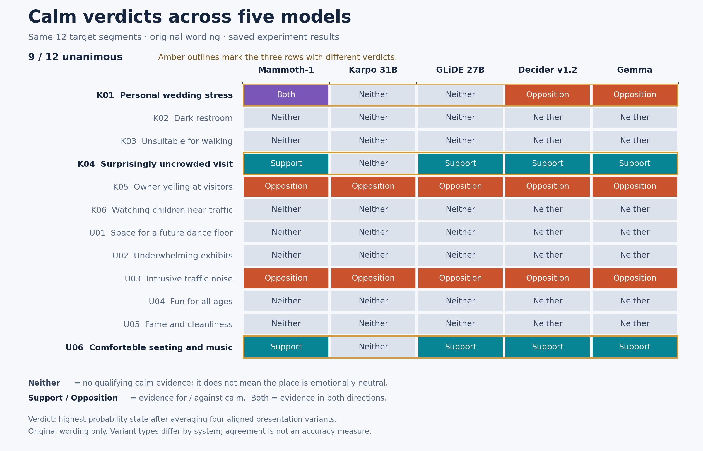
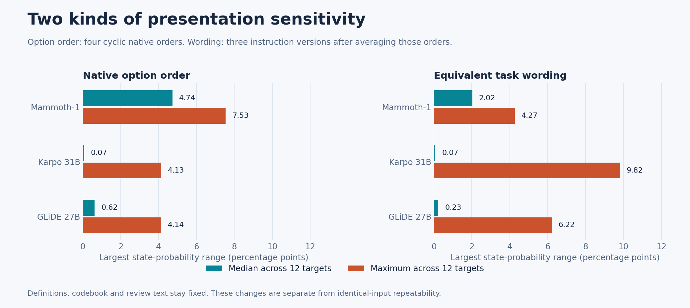

# Native decision-model comparison: Mammoth, Karpo and GLiDE

Discussion and completed experiment, November 24, 2026.

The earlier PPLX-Decider test established exact repeatability in its tested native path, direct access to raw option scores, and modest order sensitivity. Its twelve combined verdicts matched Gemma, including the known wedding-stress attribution error. That result motivated looking for a probability reader with both reproducible scores and faithful emotion attribution.

The researcher supplied six further candidates, initially requested evaluation only, and then selected the first three for testing. Mammoth-1 offered relevant public evidence on equivalent-question consistency, with the important caveat that abstention helped drive that result. Karpo offered a Gemma-family decision fine-tune; GLiDE offered another native decision approach. d3-ultra, Clef and hosted Drex were not tested here. The researcher also asked whether Ollama availability was required. It was not: all three selected models were executed with published weights and their native Python implementations on Runpod.

The [completed report](../research_audit/stage1a_three_decision_models_12_2026-11-24/README.md) contains the exact model/runtime pins, original inputs, raw evidence, three charts, full probability exports and case-level assistant audit.

## Graphics

### Verdicts across all five models

[Open the verdict chart at full size](../research_audit/stage1a_three_decision_models_12_2026-11-24/five_model_verdict_comparison.png) · [Vector graphic](../research_audit/stage1a_three_decision_models_12_2026-11-24/five_model_verdict_comparison.svg) · [Exact verdicts and target segments](../research_audit/stage1a_three_decision_models_12_2026-11-24/five_model_verdict_comparison.csv).

All five models agree on **9 of 12** targets. Gemma and Decider agree on **12 of 12**. Karpo returns neither on the two inferred positives (uncrowding and comfortable seating/music), while the other four return support. For personal wedding stress, Mammoth returns both, Karpo and GLiDE return neither, and Decider and Gemma return opposition.

Each cell takes the highest-probability state after the arithmetic mean of four semantically aligned, original-wording vectors. Gemma uses the saved T=1 mapping mean; its T=4 mapping mean gives the same twelve verdicts. New models and Decider jointly vary criterion order and native codes; Gemma varies letter assignment at fixed definition order. These are saved-system comparisons, not a common controlled order manipulation or an accuracy ranking. Original-wording presentation flips for Mammoth K01 and GLiDE U06 are hidden by a single aggregate cell; the full distributions and sensitivity results remain below.

### Probability distributions

Original-wording probability profiles for the four audited cases, comparing the three new models with saved Qwen, Gemma and Decider results. Gemma T=4 is illustrative softening; cross-model confidence calibration is untested.

[Open the probability chart at full size](../research_audit/stage1a_three_decision_models_12_2026-11-24/four_case_probability_comparison.png).

### Order and wording sensitivity

Median and worst probability shifts across the twelve targets. The wording panel averages four aligned option-order vectors per wording; these shifts are separate from identical-input repeatability.

[Open the sensitivity chart at full size](../research_audit/stage1a_three_decision_models_12_2026-11-24/order_and_wording_sensitivity.png).

## Executed design

Same twelve real targets, unchanged full v0.5 codebook, calm only. For each model: 480 original-wording evaluations, 288 evaluations under two equivalent task-instruction paraphrases, and twelve canonical requests after unload/reload. The completed planned total is **2,340 decisions**. Original-wording requests match the saved Decider requests; the new wordings preserve the reviews, codebook and criterion definitions.

All three produced identical raw scores and analysis probability vectors across their repeated inputs and all reload checks. Four cyclic native option orders jointly change positions and internal codes, so these are not Gemma's old isolated letter-assignment conditions. Prediction aggregation remains the arithmetic mean of semantic-aligned probability vectors; median gaps summarize typical sensitivity across the twelve targets.

| Model | Median / worst original order gap | Worst wording gap after four-order averaging | Reading that matters |
|---|---|---|---|
| Mammoth-1 | 4.74 / 7.53 pp | 4.27 pp | Retains the personal-stress attribution error; its winning interpretation changes across presentations |
| Karpo 31B | 0.075 / 4.13 pp | 9.82 pp | Cleaner attribution and strict acceptance; rejects the two plausible positive T inferences as winners |
| GLiDE 27B | 0.62 / 4.14 pp | 6.22 pp | Retains the positive T inferences; seating/music is effectively a support/neither tie |

The mean winners remain unchanged across the three wordings for Karpo and GLiDE, but this does not erase individual presentation effects. Their seating/music case changes winner in some matched orders. Karpo's worst wording gap with order held fixed is **13.54 pp**. Mammoth's wedding target changes mean winner between both and opposition; the appropriate neither reading still receives only 23.00% in its original mean.

## Probability interpretation and case audit

For wedding logistics, Karpo assigns neither **88.33%**, GLiDE **56.28%**, and Mammoth **23.00%**. Mammoth allocates **66.81%** to states containing opposition; GLiDE retains **37.05%** there despite its appropriate winning state. A lower maximum probability or correct winner alone does not establish that the full soft vector is suitable for training. The separate gate can reject this review, so its correction is diagnostic rather than a measured production gain.

For uncrowding, Karpo assigns neither **67.79%** and support **32.11%**, while GLiDE assigns support **87.01%**. For comfortable seating/music, Karpo is neither **60.41%** versus support **39.51%**; GLiDE is support **49.83%** versus neither **49.05%**. This exposes the main project choice: how reliably the text scorer retains defensible T evidence. Prior general agreement on Gemma boundary cases is not a new human annotation of these models' probabilities.

Neither remains absence of qualifying evidence, not abstention. Both requires grounded claims in both directions and cannot be used as a general uncertainty bucket. Native probability scores remain model preferences among those configurations; task calibration, emotion intensity and downstream training usefulness were not established.

## Execution clarification and resource cleanup

The initial Mammoth harness stopped because its native API rounds probabilities to six decimals and the numerical check compared against unrounded values. The first attempt was retained, the check was corrected through the official formatter, and the unchanged full schedule was rerun. Raw logits, rounded native values and unrounded native softmax are all preserved. Karpo's full formatter was also verified offline. No model weights, temperatures, codebook definitions or review inputs were tuned in response to these results.

The complete archive and 165 manifest-listed files were verified before the owned GPU was terminated. Estimated compute was **$1.89** at **$2.69/hour**, below the agreed budget; a fresh post-termination pod list was empty.

**Current assessment:** keep Karpo and GLiDE as the most useful new finalists, with explicit attention to strictness versus retention of indirect calm evidence. Mammoth's public consistency result does not establish superiority on this task. These twelve targets lack an unambiguous explicitly worded positive-calm control, so a separate balanced review set is needed before broader recall or calibration claims. No production pipeline, training weights or image-grounding method is changed.
