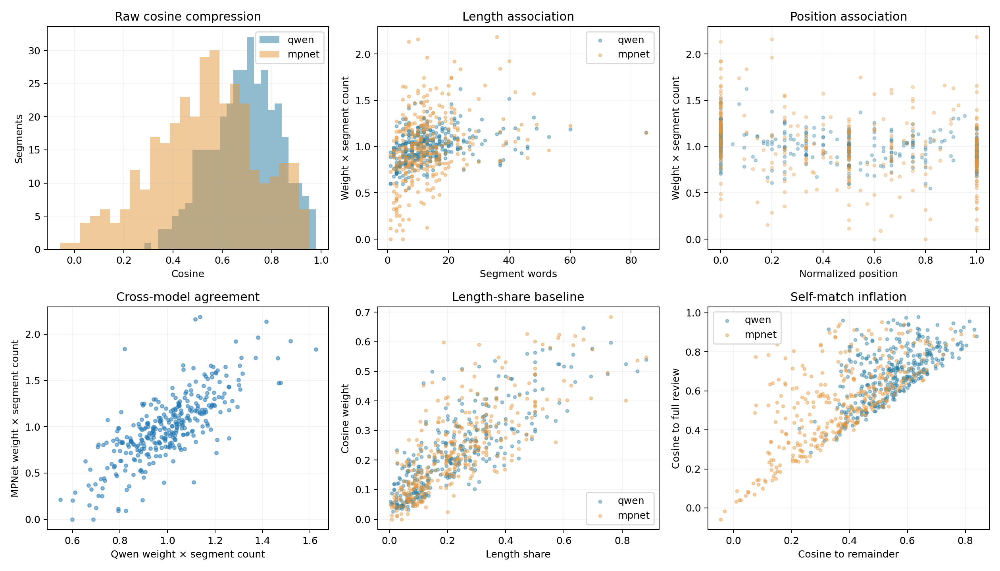

# Embedding representativeness: 100-review results

Completed 2026-11-24. Qwen3-Embedding-8B and all-mpnet-base-v2 processed 100 real reviews, 379 segments, across 43 places. This is an initial diagnostic pilot, not a validated measure of semantic representativeness.

| Check | Qwen3-Embedding-8B | MPNet |
|---|---:|---:|
| Multi-segment reviews eligible | 80 | 79 |
| Segments in those reviews | 359 | 336 |
| Median within-review weight–length Spearman ρ | 0.50 | 0.50 |
| Median within-review weight–position Spearman ρ | −0.40 | −0.40 |
| Mean full-review minus remainder cosine | +0.138 | +0.165 |
| Mean absolute weight difference from length share | 6.90 percentage points | 7.54 percentage points |
| Mean absolute weight difference from uniform | 2.66 percentage points | 5.66 percentage points |
| “staff were rude” vs “staff were lovely” cosine | 0.784 | 0.661 |
| Staff complaint vs unrelated building cosine | 0.297 | 0.078 |

Within-review correlation summaries require at least three segments: 61 Qwen reviews and 60 MPNet reviews. Position is normalized from first=0 to last=1. Negative correlations indicate higher weights earlier in the review. These are observed associations, not causal bias estimates.

Cross-family agreement is reasonably strong: median within-review rank correlation **0.743** over 60 reviews with at least three segments. Relative weights (weight × segment count) correlate **0.754** over 336 shared segments. The naive pooled normalized-weight correlation is 0.928, but much of that can reflect the shared 1/n normalization; do not report it alone.

Length matters, but the cosine weights are not equivalent to length-share weights. Both length and position associations remain in review fixed-effects regression after adjusting for log word count and normalized position (see summary.json for review-cluster bootstrap intervals). Review introductions may naturally summarize the review, so first-position association alone does not prove encoder position bias.

Reversing clause order gives median within-review rank agreement of 0.793 for Qwen and 0.900 for MPNet. This suggests some Qwen order sensitivity; reversal also changes discourse. Removing the target segment lowers cosine by 0.138 and 0.165 on average. Remainder similarity is a self-match diagnostic, not interchangeable with full-review representativeness.

Qwen weights are more compressed toward uniform than MPNet weights. In review 169, “Good luck!” receives 13.6% from Qwen and 6.5% from MPNet (uniform is 20%). The polarity sanity pair is substantially more similar than the unrelated control in both models, but one pair cannot establish general sentiment invariance.

MPNet excludes one 23-segment review whose full review exceeds its 384-token limit. Its 24 over-limit unique texts include the full review and remainder variants. No input was truncated. Qwen has no over-limit inputs. Twenty single-segment reviews receive weight 1 and are excluded from association checks.

The [20-review qualitative audit](MANUAL_AUDIT.md) found generally understandable topic rankings and meaningful disagreements, along with a concrete segmentation flaw: “John F. Kennedy” is split into fragments. Topic similarity also cannot replace the gate or determine emotional importance. For example, parenting philosophy and event-booking content can be internally representative without being suitable atmospheric evidence.

**Decision:** retain Qwen as the provisional main model, MPNet as the robustness check, and the fixed proportional rule for this pilot. Keep uniform weights as a baseline. Repair abbreviation-aware segmentation and rerun this same sample before connecting these weights to emotion aggregation. This run does not establish which model is more accurate; there are no human gold representativeness labels.

Reproducibility: exact model revisions, observed package versions, GPU and input hash are in manifest.json. Source review IDs, offsets, full/remainder cosines and weights are in segment_scores.csv and input_segments.jsonl. The frozen 100-review input is selected_reviews.jsonl. The inference script now pins the model revisions observed in this run. See PROTOCOL.md for instructions and analysis details.

Compute: secure RTX 4090, listed $0.89/hour; pod created at 20:58 UTC and terminated about 21:03 UTC. Estimated compute was approximately $0.08–$0.10, plus any platform disk charges; this is an estimate, not an invoiced amount. Confirmed no pods remain after termination.
