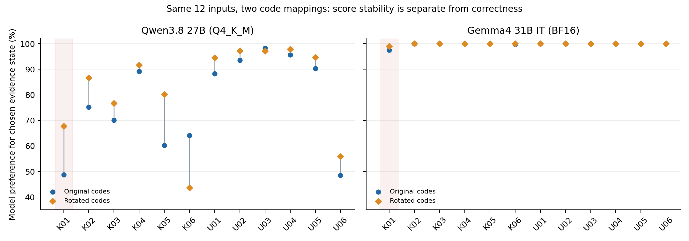

# Calm native-probability pilot — 12 matched reviews, November 23, 2026

**Status: executed development pilot.** 72 main calls across the same 12 original target segments/full reviews and the same two model digests used in the v0.5 study. One additional JSON-interface preflight failed atomic-code validation and is archived separately. No gate, cascade, new training or independent held-out evaluation was run.

## What this test establishes

**November 23 interpretive follow-up:** each mapping was run once per case/model; there is no repeated-identical-request probability baseline in this experiment. The numerical gap below is an observed difference between mappings, not an isolated estimate of a letter effect or a question-wording test. Gemma's near-1 saturation can also conceal underlying score variation. See the [stability, stabilization and logits discussion](../../Discussions/model-probability-stability-and-logits-2026-11-23.md) for the literature, corrected interpretation and proposed repeat controls. Raw requests, results and numerical analysis remain unchanged.

**Native decision probabilities can be captured in a clear, mathematically defined way. They are neither forced to 0/1 by greedy decoding nor generated confidence ratings.** Both models produced valid single-code measurements on all 24 readouts per model. However, score robustness differed: Qwen's chosen states were stable while probabilities moved appreciably after code renaming; Gemma was nearly saturated and confidently retained a known attribution error. This supports further testing, not automatic adoption as evidence-quality weights.

| Measurement | Qwen | Gemma |
|---|---:|---:|
| Matched main calls | 36 | 36 |
| Extraction outputs passing schema/quote checks | 12/12 | 11/12 |
| Valid native first-code readouts | 24/24 | 24/24 |
| All four alternatives returned | 24/24 | 7/24 |
| Chosen-state changes after code rotation | 0/12 | 0/12 |
| Readouts with chosen-state probability ≥99.9% | 0/24 | 21/24 |
| Largest semantic state-score change after code rotation | 23.26 pp | 1.50 pp |
| Mean total-variation distance after code rotation | 9.24% | 0.14% |

A winning state can have less than 50% probability in this four-way task. For K01, Qwen's original-code neither probability is 48.73%, while the sum of the other three states is 51.27%; state argmax and a binary any-evidence threshold are different decision rules. No both-state winner occurs in this small batch, so its behavior is not validated.

All chosen states were unchanged across the two code mappings. This checks one code permutation only; it does not demonstrate invariance to arbitrary prompts, option order, other checkpoints or new locations.

Higher plotted confidence does not imply greater correctness. The vertical highlight marks K01, whose calm attribution was previously adjudicated as no place-attributed evidence.

## Matched method and the necessary interface refinement

1. **Existing extraction, narrowed to CALM:** retain the original v0.5 evidence rules, empty claim lists, opposing/supporting claims, exact source quotes and E/T. Change only the emotion scope and corresponding schema cardinality; also log native token probabilities.
2. **Companion source-level probability readout:** assess the same original target and full context directly, using four exhaustive evidence configurations: neither, support only, opposition only, both. This is an experimental measurement probe, not a replacement adopted for the project pipeline.
3. **Code control:** original mapping A/B/C/D corresponds to neither/support/oppose/both; rotated mapping B/C/D/A preserves semantic option order and changes only the code assigned to each state. Every case receives both variants for both models.

The initial Qwen JSON-string preflight combined the opening quote and state code into one token (`"A`). It failed our clean-code alignment check. The revised readout requests a single plain letter, disables JSON grammar only for that readout and limits generation to one token. Every valid measured code is therefore the first generated token, before quotes, explanations or other generated evidence. This does not mean JSON probabilities are inherently unusable; it makes this specific measurement unambiguous.

For candidate code k, use its returned native likelihood p(k). A state probability **conditional on the four canonical response codes** is q(k) = p(k) / sum(p(A), p(B), p(C), p(D)). These are model preferences over this defined readout, not calibrated probabilities of correctness or measurements of emotional intensity. Raw token likelihoods are retained separately. The model is never asked to output numeric confidence.

**Alternative coverage:** Qwen returns all four codes on 24/24 readouts. Gemma returns all four on 7/24; 17 readouts omit extremely unlikely alternatives from the top-20 list. These omissions are not zeros. Offline analysis bounds their probabilities by the reported top-k cutoff. The widest conditional-state interval for Gemma is below 0.000008 percentage points. Complete Gemma vectors remain marked unavailable where alternatives are missing, despite tight bounds.

Unrounded log probabilities and the full raw responses are preserved. Bounds in `analysis_details.json` and `comparison.csv` are authoritative: offline analysis uses the top-k cutoff directly rather than subtracting rounded dominant probabilities from one. The frozen runner and its original diagnostic fields remain unchanged for audit.

## Important cases

### K01: personal-event stress and conditional probability meaning

The target says “It was so stressful but her humanity made everything so much better!” Full context attributes the stress to a late photographer. The user's calm adjudication was **no place-attributed directional evidence**.

- Both calm-only extractions still produce an opposing claim from “It was so stressful.”
- Qwen's likelihood for the generated direction-token path `op` + `poses`, conditional on its already chosen quote, is **98.45%**. Gemma's corresponding `opp` + `oses` path likelihood is **99.9926%**. These are likelihoods of the selected canonical token paths, not distributions normalized over every possible direction string or probabilities that the claims are valid.
- Qwen's standalone readout instead chooses **neither**, at **48.73%** in the original coding and **67.66%** after rotation.
- Gemma's standalone readout chooses **opposition**, at **97.56%** and **99.07%** respectively, retaining the known attribution error with high preference.

The direction-after-quote and source-level readout measure different conditional decisions under different prompts. Their difference is not evidence that merely retaining probabilities improves accuracy. It demonstrates why we must specify the decision and conditioning context before putting a number into the emotion representation.

### U03 and U06: score variation is observable

Qwen assigns **98.31%** to opposition for U03's intrusive traffic noise, versus **48.48%** to support for U06's relaxed sitting/lights/music experience in the original coding. Its scores therefore retain distinctions discarded by hard labels. Whether those distinctions improve training remains untested. The user had adjudicated U06 as supporting calm.

### K04: source-boundary failure retained

Gemma emits “without the usual hustle and bustle” as an E quote. That phrase occurs in the full review but not in the fixed target segment. The extraction fails exact-target quote validation; it is not counted as empty or retried. Both models also infer calm from low crowding, a previously flagged conceptual boundary requiring researcher review. No new human gold label is assigned to K04 here.

## Case-by-case readout

“Support,” “oppose,” “neither” and “both” below are semantic states, not literal A–D output codes. Percentages are chosen-state probabilities conditional on the four codes. Gemma values with omitted alternatives use tight lower bounds; full precision and missingness are in the CSV/JSON.

### Qwen3.8 27B (Q4_K_M)

| Case | Calm-only extraction | Original-code readout | Rotated-code readout | Largest state-score change |
|---|---|---|---|---|
| K01 | oppose | neither (48.7%) | neither (67.7%) | 18.93 pp |
| K02 | neither | neither (75.1%) | neither (86.7%) | 11.52 pp |
| K03 | neither | neither (70.2%) | neither (76.7%) | 6.58 pp |
| K04 | support | support (89.2%) | support (91.6%) | 2.56 pp |
| K05 | oppose | neither (60.3%) | neither (80.2%) | 19.92 pp |
| K06 | neither | oppose (64.1%) | oppose (43.7%) | 23.26 pp |
| U01 | neither | neither (88.3%) | neither (94.6%) | 6.27 pp |
| U02 | neither | neither (93.5%) | neither (97.3%) | 3.81 pp |
| U03 | oppose | oppose (98.3%) | oppose (97.1%) | 1.41 pp |
| U04 | neither | neither (95.7%) | neither (97.9%) | 2.21 pp |
| U05 | neither | neither (90.3%) | neither (94.6%) | 4.28 pp |
| U06 | support | support (48.5%) | support (56.1%) | 7.58 pp |

### Gemma4 31B IT (BF16)

| Case | Calm-only extraction | Original-code readout | Rotated-code readout | Largest state-score change |
|---|---|---|---|---|
| K01 | oppose | oppose (97.6%) | oppose (99.1%) | 1.50 pp |
| K02 | neither | neither (>99.99%) | neither (>99.99%) | 0.00 pp |
| K03 | neither | neither (>99.99%) | neither (>99.99%) | 0.00 pp |
| K04 | invalid quote | support (>99.99%) | support (>99.99%) | 0.00 pp |
| K05 | oppose | oppose (>99.99%) | oppose (>99.99%) | 0.00 pp |
| K06 | neither | neither (99.8%) | neither (100.0%) | 0.16 pp |
| U01 | neither | neither (>99.99%) | neither (>99.99%) | 0.00 pp |
| U02 | neither | neither (>99.99%) | neither (>99.99%) | 0.00 pp |
| U03 | oppose | oppose (>99.99%) | oppose (>99.99%) | 0.00 pp |
| U04 | neither | neither (>99.99%) | neither (>99.99%) | 0.00 pp |
| U05 | neither | neither (>99.99%) | neither (>99.99%) | 0.00 pp |
| U06 | support | support (>99.99%) | support (100.0%) | 0.01 pp |

## Interpretation and next bounded test

- **Feasibility: demonstrated.** The one-token response code provides a clean native probability signal. Both exact model digests support native logprobs through Ollama 0.40.17.
- **Hard-label stability: observed for this code swap.** Both models keep 12/12 states; their original-code states disagree with each other on K01, K05 and K06. Agreement is not correctness.
- **Score stability: limited for Qwen.** The largest state-probability movement is 23.26 percentage points despite unchanged chosen states. Do not assume arbitrary code names leave the emotion vector unchanged.
- **Gemma's raw soft targets are close to hard labels.** 21/24 chosen-state probabilities exceed 99.9%. Their small alternative likelihoods remain available in unrounded form or bounded; later calibration/temperature-based softening might still be informative, but was not tested here.
- **General claim-quality weighting: not established.** K01 is a concrete high-confidence attribution failure. The two explicit calm adjudications and this reused development set cannot establish 12-case accuracy, AUROC or calibration.
- **Training value: not tested.** A next bounded study should compare hard labels with actual soft targets and with constant-smoothing/shuffled-probability controls, preserving the same data splits and matching. No student/image model was trained in this pilot.

## Reproduction and files

- [Frozen protocol](PROTOCOL.md), [runner](run_pilot.py), [manifest](manifest.json), [offline analysis](analyze_results.py).
- [Summary](analysis_summary.json), [case details and corrected bounds](analysis_details.json), [CSV comparison](comparison.csv), [original runner summary](summary.json).
- [Raw result archive](raw_results_bundle.tar.gz): all 72 full requests/responses with native token alternatives, model runtime metadata, prompts, logs and the separate failed JSON-interface preflight.
- [Source manifest](source_manifest.json) and [source fetch helper](fetch_sources.py) recover the exact public input files at commit `79a6e4b61ec962661355aec898ca577551e87b47`; no synthetic review cases were used. To rerun, fetch sources, then run `python run_pilot.py prepare` before leasing compute. Existing manifests prevent silent drift or accidental mixing of runs.
- Models: Qwen3.8 27B **Q4_K_M** (`aaee06c39dcf2437cde036998d960e1fc1494b8191be7cc9657d01e509097813`); Gemma4 31B IT **BF16** (`df1661a2a6aaa94faf24bbaf23a691877a27d0e6052598f105a225618a079e76`). They match prior digests but differ in family and quantization; probabilities should not be presumed cross-model calibrated.

## Compute and cleanup

One RTX PRO 6000 Blackwell Server Edition 96 GB pod at the advertised **$2.69/hour**, with no persistent volume. All results were downloaded and SHA256-verified before termination. The subsequent pod list was empty.

Lease duration was approximately **18.3 minutes**, giving an estimated compute cost of **$0.82**, excluding any separate storage charges. This is an estimate, not an itemized bill. See [cleanup record](cleanup.json) and [runtime](runtime_system.json).
