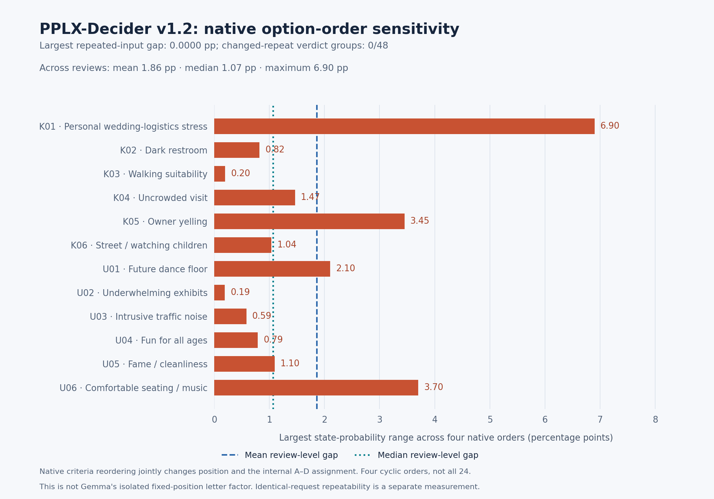
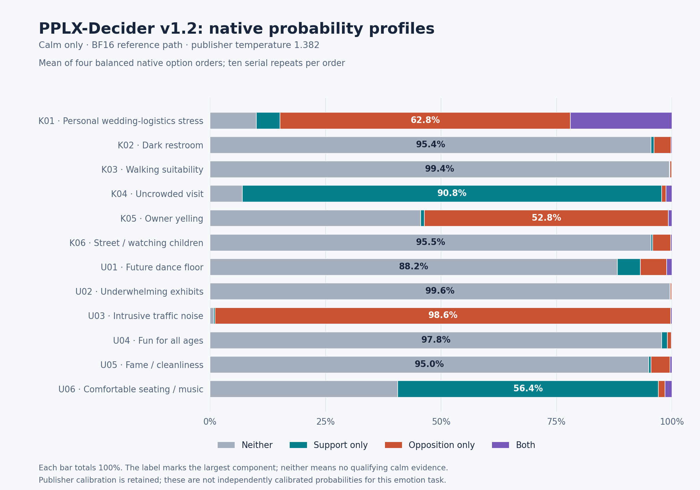

# PPLX-Decider v1.2: executed twelve-review calm probability test

Executed November 24, 2026. This is a completed inference experiment, not a proposed run. It tests the model named in the side discussion: **`perplexity-ai/pplx-decider-v1.2`**, rather than an older Ollama artifact with a similar name.

**Finding:** the official BF16 reference implementation was exactly repeatable on all tested inputs and showed limited, measurable option-order sensitivity. Its distributions differ meaningfully from Gemma's, but its combined verdicts match Gemma on all twelve cases, including the known personal-stress attribution error. These results support further evaluation of this probability reader; they do not establish calibrated emotion confidence or improved interpretation.

## What was held constant

- The same twelve real target segments and their full reviews from the earlier probability experiments, byte-identical in `inputs.jsonl`.
- Calm only, with the unchanged full v0.5 codebook. Context resolves attribution; evidence must come from the target segment.
- Four mutually exclusive evidence states: **neither**, **support only**, **opposition only**, and **both**. Neither means no qualifying calm evidence; both means evidence in both directions. Neither is not an uncertainty bin, and both is not uncertainty between the other states.
- This diagnostic reuses deliberately difficult targets, including reviews that can fail the separate place gate. The gate was not rerun. Results do not describe the acceptance rate or accuracy of a gate-filtered production pipeline.

The native request carries the target and full review in `state`, the original codebook and task in the question instructions, and the four state definitions as criteria. Only the generation-specific instruction to output a response token is replaced by the official decision interface. The actual requests, rendered text, token IDs and input hashes are retained. Inputs use 2,511–2,627 tokens, below the 8,192-token limit; none required truncation or question splitting.

## How the model was run

| Item | Actual setting |
|---|---|
| Checkpoint | `perplexity-ai/pplx-decider-v1.2` |
| Frozen revision | `cce0f3f80033e9d89d80831d5281fd72124aacce` |
| Backbone | Qwen3.8-27B, native BF16 with a separate decision readout head |
| Interface | Official Python `Decider`, `fast=False`, serial, one request at a time |
| Attention / cache | Official noncausal reference attention; no KV cache and no generated answer tokens |
| Temperature | Publisher's saved **1.3823494677922652**, applied exactly once |
| Raw scores | All four pre-temperature readout logits, plus T=1 and native-temperature probabilities |
| GPU | RTX PRO 6000 Blackwell Server Edition, 96 GB |
| Stack | Python 3.12.3; torch 2.14.0+cu130; transformers 5.17.0; exact versions in `runtime.json` |
| Seed / numerical controls | Seed 42; no FP8, additional quantization, packing or compilation; PyTorch deterministic-algorithms flag remained false |

This is a dedicated classification readout, not an instruction to a generative model to invent probabilities or produce a letter. The official API exposes its raw logits directly. The model still internally assigns answer codes to criteria, so the interface does not remove all position or code effects.

For each question, the four valid logits are divided by the publisher temperature and passed through float32 softmax, then the official answer formatter. Twelve additional `.decide` calls exactly matched this reconstruction: **zero probability difference and identical selected states**. The publisher temperature was not fitted on these reviews. Calibration on the publisher's data does not establish calibration for our emotion task.

The API's `confidence` field is, for four choices, `clip((max_probability - 0.25) / 0.75, 0, 1)`. It contains no information beyond the largest probability; it is not a second estimate of correctness.

## Test design and counts

Each of the twelve cases was tested in four cyclic criteria orders. Each state occupies every position once. Each of the resulting **48 unique requests** was evaluated ten times, in shuffled repeat blocks: **480 main readouts**.

The model was then unloaded and reloaded from the same frozen checkpoint. The twelve canonical-order requests were evaluated again. In addition, the twelve canonical requests in the first main block had the extra official `.decide` alignment call described above.

| Component | Recorded readouts | Model forward passes |
|---|---:|---:|
| 12 cases × 4 orders × 10 repeats | 480 | 480 |
| Canonical requests after one reload | 12 | 12 |
| Additional official `.decide` alignment checks | Nested in 12 main records | 12 |
| **Total** | **492 records** | **504** |

There was no cached warm-versus-cold treatment: every reference forward recomputes the request without a KV cache. We did not enable an accelerated serving route or change backends between treatments. This is observed repeatability on one GPU/software configuration, not a guarantee across hardware or library versions.

**Important comparison limit:** reordering native criteria jointly changes option positions and their internal A–D assignments. This is not Gemma's earlier isolated letter-assignment test with fixed definition order. Four balanced cyclic orders are not all 24 permutations and do not test wording paraphrases.

## Repeatability and option sensitivity

| Measurement | Observed result |
|---|---:|
| Largest raw-logit range across identical repeats | **0** |
| Largest probability range across identical repeats | **0.0000 percentage points** |
| Unique requests with identical logits and probabilities in all ten repeats | **48 / 48** |
| Repeat groups with changed verdicts | **0 / 48** |
| Canonical requests matching exactly after reload | **12 / 12**, logits and probabilities |
| Cases with a changed verdict across four orders | **0 / 12** |
| Median review-level order gap | **1.0675 percentage points** |
| Mean review-level order gap | **1.8623 percentage points** |
| Maximum review-level order gap | **6.9005 percentage points**, K01 |

For each review, the order gap is the largest max-minus-min probability range of any one semantic state across the four orders. The median and mean summarize these twelve gaps. They are separate from prediction aggregation, which uses the **arithmetic mean of four semantic-aligned vectors**. Repeats are not counted as independent reviews.

The reload comparison against the first actual readout is exactly zero. Comparing with an arithmetic average of ten identical vectors can produce about 2.2e-14 percentage points of floating-point averaging roundoff; that is not observed model variation.

## Probability profiles

The mean winning probability across main requests is **86.02%** at the publisher temperature, versus **89.81%** at T=1. No main request has a winning probability at or above 99.9%. Median serial forward latency is **0.648 seconds**, excluding model loading and the extra alignment calls.

The table below averages the four semantic-aligned native distributions. It is not a set of human-assigned probabilities or emotion intensities.

| Case | Target topic | Neither | Support only | Opposition only | Both | Largest order gap (pp) |
|---|---|---:|---:|---:|---:|---:|
| K01 | Personal wedding-logistics stress | 10.02% | 5.13% | 62.82% | 22.03% | 6.90 |
| K02 | Dark restroom | 95.44% | 0.65% | 3.70% | 0.21% | 0.82 |
| K03 | Walking suitability | 99.42% | 0.17% | 0.31% | 0.09% | 0.20 |
| K04 | Uncrowded visit | 7.00% | 90.76% | 0.94% | 1.31% | 1.47 |
| K05 | Owner yelling | 45.59% | 0.81% | 52.81% | 0.79% | 3.45 |
| K06 | Street / watching children | 95.47% | 0.35% | 3.87% | 0.31% | 1.04 |
| U01 | Future dance floor | 88.17% | 5.00% | 5.69% | 1.14% | 2.10 |
| U02 | Underwhelming exhibits | 99.58% | 0.09% | 0.27% | 0.06% | 0.19 |
| U03 | Intrusive traffic noise | 0.78% | 0.31% | 98.64% | 0.27% | 0.59 |
| U04 | Fun for all ages | 97.78% | 1.19% | 0.85% | 0.18% | 0.79 |
| U05 | Fame / cleanliness | 94.98% | 0.44% | 4.17% | 0.41% | 1.10 |
| U06 | Comfortable seating / music | 40.65% | 56.42% | 1.39% | 1.54% | 3.70 |

## What the text audit says

The [qualitative audit](QUALITATIVE_AUDIT.md) reads the target and context against the codebook. It is a current assistant assessment, informed by the earlier discussion, not a blinded benchmark or a new human annotation exercise. No inherited reference table is treated as independent ground truth, and no accuracy, NLL, Brier or error-ranking score is claimed here.

- **K01, personal wedding-logistics stress:** the known attribution error remains. Opposition only receives **62.82%**, both **22.03%**, and neither only **10.02%**. The appropriate neither reading is that stress comes from the late photographer and personal event logistics, not the place's atmosphere. A lower winning probability does not establish better uncertainty: **84.85%** still goes to states containing opposition. Gemma's illustrative T=4 vector put **19.86%** on neither, more than Decider does. Decider's additional both mass is also unsupported by the site-attribution rule.
- **K05, owner yelling:** opposition **52.81%**, neither **45.59%**. This exposes a plausible boundary between a disturbing encountered interaction and insufficient evidence of the place's calm atmosphere. It is a meaningful alternative distribution, but its numerical proportions are not validated.
- **U06, comfortable seating and music:** support **56.42%**, neither **40.65%**, versus Gemma T=4 support **92.15%**. The weaker commitment is plausible because comfort and music can support an inference without directly establishing tranquility. It is not automatically more accurate.
- **K06, watching children near a road:** neither **95.47%**, opposition **3.87%**. This strongly separates a safety/vigilance statement from calm. It also leaves little mass on a defensible agitation inference; that remaining codebook boundary is not settled by the distribution.
- **U03, explicitly intrusive traffic noise:** opposition **98.64%** is consistent with the target's direct calm-related disturbance. Most unrelated-content targets receive strong neither probabilities.

Decider outputs no explanation in this setup. The attribution and boundary explanations above are the assistant's reading of the text and numbers, not extracted model reasoning.

## Comparison with the saved Gemma and Qwen runs

All **12 / 12** Decider order-mean verdicts match the saved Gemma mapping-mean verdicts. Compared with saved Qwen semantic-order means, three verdicts differ: K01 and K05 are opposition rather than neither; K06 is neither rather than opposition. These are agreements and disagreements, not a correctness ranking.

The saved Qwen semantic-order experiment reported median **6.29** and maximum **39.94** percentage-point gaps, versus **1.07** and **6.90** here. This is an encouraging descriptive contrast. It is not an architecture-only or head-only ablation: checkpoint, precision, runtime, attention, prompt wrapper and answer representation differ. Likewise, Gemma's T=4 letter-only gaps cannot be directly ranked against Decider's joint order/code factor.

The lower saturation and direct access to raw decision logits make Decider a useful candidate for the probability side study. They do not establish that its values are calibrated, transferable across models, or valid emotion-intensity labels. Native publisher calibration is preferable to arbitrarily selecting a visually appealing temperature, while still requiring task-specific validation before confidence weighting or training supervision.

**Current recommendation:** retain this as a successful stability and readout-access test. Do not replace the text pipeline or adopt its probabilities as training weights from these twelve cases alone. The next informative check would use a separate, small, human-reviewed set of gate-eligible targets and distinguish semantic boundary errors from option-order and paraphrase sensitivity. That further test was not run here.

## Runtime, integrity and cleanup

The owned GPU pod was terminated after download and verification. A fresh post-termination pod list was empty. The upper-duration compute estimate is **$0.59** at the observed **$2.69/hour**; this is not a provider invoice and excludes any extra provider storage charges. `cleanup.json` preserves the timestamps and calculation.

All downloaded raw evidence was verified before termination: **36 manifest-listed files and 492 readouts**. The frozen raw archive has SHA-256 **`5404584c45c5c36b993a83fb8c53419d9d48c65eaf3511615b3aeeab1dae9c67`**. It includes original execution files, licensed reference source and logs, not the 52 GB model weights. The checkpoint source revision and weight integrity results are retained for reproduction. The larger `requests.jsonl` and `rendered_requests.json`, original logs and licensed source are supplied inside that archive; extract them into this folder when needed. The raw readouts and smaller analysis/input artifacts are also available directly.

## Files and reproduction

| Files | Purpose |
|---|---|
| `PROTOCOL.json`, `inputs.jsonl`, `codebook_v05.md`, `decision_instructions.txt`, `requests.jsonl` | Frozen design and actual input requests |
| `rendered_requests.json` | Actual rendered prompts, token IDs and readout positions |
| `model_source_manifest.json`, `hf_metadata.json`, `checkpoint_integrity.json` | Exact checkpoint/source revision and integrity |
| `run_decider.py`, `bootstrap.py`, `runtime.json`, `RUN_COMPLETE.json` | Executed code, dependency installation, runtime and completion evidence |
| `readouts.jsonl` | All raw logits, T=1/native distributions, orders, repeats and nested SDK alignment checks |
| `raw_results_bundle.tar.gz`, `INTEGRITY.json`, `archive_integrity.json` | Unmodified execution bundle and hash verification |
| `analyze_decider.py`, `summary.json`, the four CSVs | Offline analysis and case-level exports |
| `baseline_vectors.json` | Cached earlier Qwen/Gemma comparisons; not new inference |
| `plot_decider.py`, the two PNGs | Figures derived from saved results |
| `QUALITATIVE_AUDIT.md`, `qualitative_audit.json` | Assistant reading, provenance and unresolved boundaries |
| `cleanup.json` | Resource termination and compute-cost evidence |

To reproduce offline analysis, install NumPy and Matplotlib and run `python analyze_decider.py` then `python plot_decider.py` in this folder. To reproduce GPU inference, obtain the pinned checkpoint and its author-pinned dependencies, keep the supplied request insertion order, set `DECIDER_CHECKPOINT` to its local path, and run `run_decider.py` in a clean copy without an existing `readouts.jsonl` because that file is append-only. The original licensed source is in the raw archive. `bootstrap.py` records the actual installation/download path used; it assumes the original Runpod directory layout. Do not rerun it on a paid pod without considering the runtime budget.

## Primary sources

- [Pinned model card and native usage](https://huggingface.co/perplexity-ai/pplx-decider-v1.2/blob/cce0f3f80033e9d89d80831d5281fd72124aacce/README.md).
- [Exact decision configuration and publisher temperature](https://huggingface.co/perplexity-ai/pplx-decider-v1.2/blob/cce0f3f80033e9d89d80831d5281fd72124aacce/decision_config.json).
- [Official model implementation and raw-logit API](https://huggingface.co/perplexity-ai/pplx-decider-v1.2/blob/cce0f3f80033e9d89d80831d5281fd72124aacce/source/src/pplx_decider/model.py).
- [Request protocol, criterion codes and confidence formatter](https://huggingface.co/perplexity-ai/pplx-decider-v1.2/blob/cce0f3f80033e9d89d80831d5281fd72124aacce/source/src/pplx_decider/protocol.py).

The release documentation still contains private-access wording, but the actual repository metadata was public and ungated, and the pinned checkpoint was downloaded without an access token. The retained API metadata and successful weight integrity check document the artifact actually executed.
