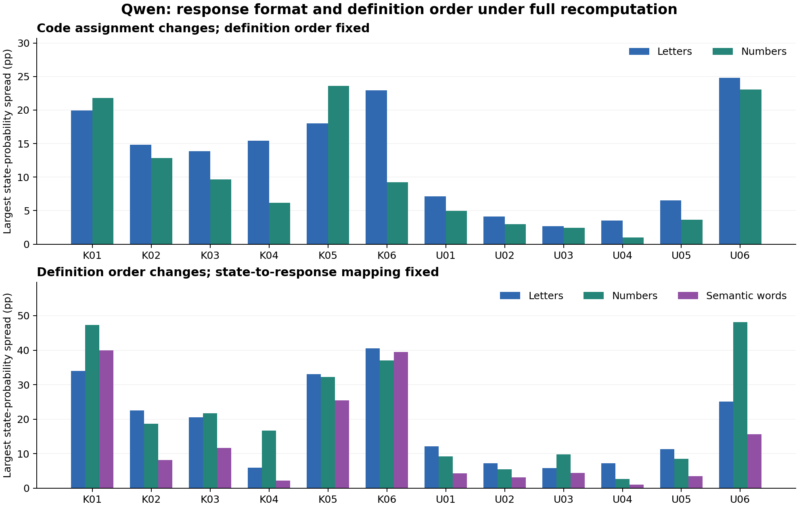
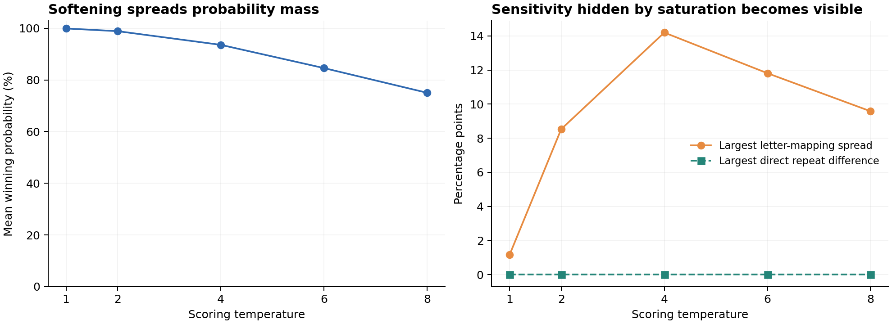

# Qwen response alternatives and Gemma softened-score evaluation

**Executed November 23, 2026.** Same twelve real reviews/target segments and calm-only v0.5 decision task. This is a representation/repeatability diagnostic; no new independent emotion labels or image-model training.

**November 24 discussion and figures:** [Gemma plausibility audit, researcher response, temperature/stability plots and mean-versus-median clarification](../../Discussions/gemma-probability-audit-temperature-and-stability-2026-11-24.md). The complete figure data and regeneration script are linked there.

## Findings

1. **Numbers improve typical code-assignment robustness, while order sensitivity remains.** Median assignment spread falls from 14.34 to 7.70 pp, with no assignment-induced verdict changes for numbers. The largest numeric assignment spread is still 23.61 pp, and reordering numbered definitions produces a 48.14-point spread.
2. **Semantic words improve typical order robustness, with remaining failures.** Median order spread is 6.29 pp against 16.36 pp for letters. Their largest spread is 39.94 pp, with changed chosen states in 1/12 cases. None of the tested formats makes a single prompted probability vector robust to all tested changes.
3. **Gemma's softened distributions reveal previously compressed letter sensitivity.** T=4 lowers mean winning probability to 93.57%, while mapping differences reach 14.20 pp. Its sixteen saved direct repeat pairs remain identical. Softening and computational repeatability answer different questions.

**Usefulness check added:** [Gemma probability signal versus fixed smoothing](GEMMA_SIGNAL_EVALUATION.md) evaluates the recorded reference judgments and case influence. No robust added usefulness is established; the reference remains provisional.

## Questions and what was actually done

- **Qwen:** compare A–D, 1–4 and meaningful semantic answers; distinguish code assignment from definition order; use full prompt recomputation throughout. Reuse previously measured cold letter conditions, rather than repeating the original letter study.
- **Gemma:** evaluate the already saved 64 direct readouts, 624 native readouts and temperature grid. **Zero new Gemma model calls.**

See the [frozen protocol and tokenization amendment](PROTOCOL.md), [run manifest](manifest.json) and [twelve exact inputs](inputs.jsonl).

## Qwen design

Same Qwen3.8 27B Q4_K_M checkpoint digest, Ollama 0.40.17 and 96 GB RTX PRO 6000 Blackwell GPU class as the earlier diagnostic. The private bundled backend uses `cache_prompt=false`, temperature 0, seed 42, serial requests, n_predict=1 and native probabilities before sampling. Actual backend flags and hardware are in [runtime.json](runtime.json); MTP remains at the recorded native default.

For letters and numbers, four cyclic code assignments are tested with definition order fixed, and four cyclic definition orders with code assignment fixed. The canonical input is shared, giving seven unique versions per coded format. Unmarked definition sentences embed fixed semantic state names (`none`, `support`, `opposition`, `both`), with four cyclic orders. **Eighteen versions per review, 216 unique inputs.** These are balanced cyclic tests, not all 24 permutations or a full assignment/order interaction test.

Three runtime anchors matched the prior cold probabilities exactly: **0 maximum difference**. Baseline reuse was **True**. The new run recorded **615 readouts**, including three runtime anchors, and reused **120** original cold readouts (three reviews × four letter assignments × ten repeats). New conditions receive three shuffled cold repetitions. Old and new candidate masses are averaged per unique condition so reused repetitions do not give a review extra weight.

Initial tokenizer preflight found `neither` was two tokens. Before any scored review, the word was replaced with `none`; all twelve response strings then passed the single-token check. This verbalizer choice was based only on tokenization, not review outcomes. The initial failure is retained. The semantic format removes arbitrary IDs, while still requiring a fixed vocabulary for measurable probabilities.

The original top-20 readout is retained. **9** calls required an additional top-200 readout because a candidate was missing. These are additional completion calls beyond the readout-record count. The largest change in a shared native log probability between a top-20 and expanded readout was **0**. Missing candidates, if any, retain cutoff-based bounds. No grammar, logit bias, zero imputation or generated confidence scores were used.

## Qwen results

Spread columns are **maximum / median across the twelve cases**, in percentage points. All probabilities are conditional on the four exact response tokens; candidate mass also reports how much native probability belongs to those tokens. State-change columns count cases whose raw chosen semantic state changes within the corresponding family.

| Format | Code-assignment spread, max / median (pp) | Definition-order spread, max / median (pp) | Cases changing state: assignment / order | Mean native candidate mass | Valid exact responses |
|---|---:|---:|---:|---:|---:|
| Letters | 24.78 / 14.34 | 40.53 / 16.36 | 1 / 2 | 99.809% | 336/336 |
| Numbers | 23.61 / 7.70 | 48.14 / 17.67 | 0 / 1 | 99.642% | 252/252 |
| Semantic words | — | 39.94 / 6.29 | — / 1 | 96.751% | 144/144 |

Numbers have a smaller maximum probability spread than letters on **10/12** cases for assignment changes. Numbers have a smaller maximum probability spread than letters on **7/12** cases for order changes.

The same tendency appears in score-space diagnostics. Median canonical-winner logit-margin ranges are **1.037 for letter assignment versus 0.663 for number assignment**. For order changes they are **1.686, 2.332, 1.016** for letters, numbers and semantic words respectively. Thus the typical improvements are also visible before probability saturation; they do not establish better semantic judgments.

Letters: 84/84 conditions had identical returned state log probabilities across repeats; maximum probability-range upper bound 0 pp. Numbers: 84/84 conditions had identical returned state log probabilities across repeats; maximum probability-range upper bound 0 pp. Semantic words: 48/48 conditions had identical returned state log probabilities across repeats; maximum probability-range upper bound 0 pp.

The case table prevents lower probability variation from being mistaken for unchanged interpretation. These are observed model decisions, **not newly adjudicated ground truth**:

| Case | Canonical letters | Canonical numbers | Canonical semantic words |
|---|---|---|---|
| K01 | neither | neither | neither |
| K02 | neither | neither | neither |
| K03 | neither | neither | neither |
| K04 | support_only | support_only | support_only |
| K05 | neither | neither | neither |
| K06 | opposition_only | opposition_only | opposition_only |
| U01 | neither | neither | neither |
| U02 | neither | neither | neither |
| U03 | opposition_only | opposition_only | opposition_only |
| U04 | neither | neither | neither |
| U05 | neither | neither | neither |
| U06 | support_only | support_only | support_only |

For a concrete order failure, K06's letter readout changes from **opposition only to support only** under one reordered list. Its semantic-word readout changes from opposition only to neither under another order. The target and review context do not change.

The controlled assignment and order comparisons answer different questions. A format with lower code sensitivity can still depend on list order or change the underlying decision. Lower spread alone does not establish greater correctness or calibration; frozen semantic words may also produce saturated probabilities. [Full case comparisons](qwen_comparison.csv), [native-score margin diagnostics](qwen_analysis_details.json) and [analysis summary](qwen_analysis.json) preserve these distinctions.

## Gemma: evaluate existing scores rather than rerun

All **48 unique review/mapping inputs**, with **16 direct repeat pairs**, are evaluated at T=1,2,4,6,8. Recomputing softmax from the saved four logits reproduces every saved temperature vector with maximum absolute error **0**. Every direct repeat pair remains identical at every temperature; the winning state is unchanged. This verifies the algebra and observed repeatability in that direct backend, not universal invariance or calibrated confidence.

| Scoring temperature | Mean winning probability | Largest letter-mapping spread (pp) | Largest direct-repeat difference (pp) | Mean TV distance from matched uniform smoothing |
|---|---:|---:|---:|---:|
| 1 | 99.90% | 1.16 | 0.00 | 0.17% |
| 2 | 98.86% | 8.53 | 0.00 | 1.85% |
| 4 | 93.57% | 14.20 | 0.00 | 6.42% |
| 6 | 84.58% | 11.81 | 0.00 | 9.12% |
| 8 | 75.03% | 9.58 | 0.00 | 9.75% |

**The central finding:** at T=4, average winning probability falls from **99.90% to 93.57%**, but maximum letter-mapping variation rises from **1.16 to 14.20 pp**. K01's opposition probability ranges from approximately **68.20% to 82.40%** across the four mappings at T=4. Its verdict stays opposition, preserving the earlier attribution-error diagnosis. Softening reveals sensitivity hidden by saturation; it does not create evidence that the alternative probabilities are calibrated.

The native cached/reloaded data also contains computational variation: on the **30 condition/phase groups** with all four candidates present on every repeat, the maximum within-payload range rises from **1.55 pp at T=1** to **4.01 pp at T=4**. This is a different backend/cache condition from the repeated full-recomputation direct scores above; the two should not be pooled as interchangeable measurements.

**Practical extraction issue:** top-20 native probabilities omit some very unlikely state tokens. Those omissions become more consequential after softening: the maximum resulting state-probability interval width is **3.02 pp at T=4**, and larger at T=6/8. The direct evaluation uses all four captured logits and therefore has no such missing-state ambiguity. Do not soften rounded percentages or replace omitted candidates with zero.

For the smoothing control, each temperature is compared with fixed uniform label smoothing matched to its mean winning probability: target `(1-epsilon)*one_hot(winner) + epsilon/4`. Total variation measures how much the full case-specific distribution differs from that control. Softened Gemma vectors contain case/alternative-specific information beyond one constant smoothing level; **qualitative plausibility and provisional-reference checks are documented in the follow-ups; downstream training benefit remains untested**.

## Decisions supported at this stage

- Use the Qwen casewise assignment and order results together; do not select a format from one favorable example or probability spread alone.
- Preserve full logits and the original distributions. The saved Gemma temperature grid is repeatable in the tested direct backend, but a softened single-mapping target retains appreciable mapping sensitivity.
- Four-mapping arithmetic averages are exported for comparison. They remove dependence on which of those four captured vectors is selected, while leaving the tested encoding, systematic errors and untested permutations unresolved. No downstream improvement is claimed.
- Do not select an optimal/calibrated temperature or adopt probability supervision from these development cases. Later compare hard targets, matched fixed smoothing and model-derived soft targets on independent annotation/training validation.

## Artifacts and reproduction

- [Qwen summary](qwen_analysis.json), [case comparisons](qwen_comparison.csv), [case/factor details](qwen_analysis_details.json).
- [Gemma evaluation](gemma_evaluation.json), [all temperature vectors](gemma_temperature_vectors.csv), [four-mapping averages and support/opposition marginals](gemma_mapping_averages.csv), [source hashes](gemma_source_integrity.json).
- [Raw bundle](raw_results_bundle.tar.gz), [bundle hash](BUNDLE.json), [download verification](archive_integrity.json), [pod cleanup](cleanup.json).
- [Runner](run_formats.py), [Qwen analysis](analyze_qwen.py), [Gemma evaluator](evaluate_gemma.py), [report generator](generate_report.py), [bootstrap](bootstrap.py), [packaging](package_results.py).

The raw bundle is self-contained for Qwen: frozen codebook/source helper, all twelve inputs, prior cold observations, prompt strings, new requests/responses, tokenization and runtime records. Gemma's existing full raw evidence remains in the [preceding experiment's bundle](../stage1a_probability_repeatability_12_2026-11-23/raw_results_bundle.tar.gz); the new evaluation is derived from those hashed inputs. To reproduce its evaluation, extract that earlier bundle and set `PROBABILITY_REPEAT_ROOT` to its directory before running `evaluate_gemma.py`.

The archive preserves execution-time code; files alongside it may contain later report formatting. Verify archived contents against `INTEGRITY.json` before changes. Offline analysis uses Python/NumPy and plots use Matplotlib. This experiment changes research artifacts only; no production extraction/training configuration is adopted.

The owned pod was terminated after approximately **14 minutes**. Estimated compute at the observed $2.69/hour rate was **$0.63**; all results and hashes were verified before deletion, and the post-termination pod list was empty. See [cleanup.json](cleanup.json) for timestamps and the billing qualification.
