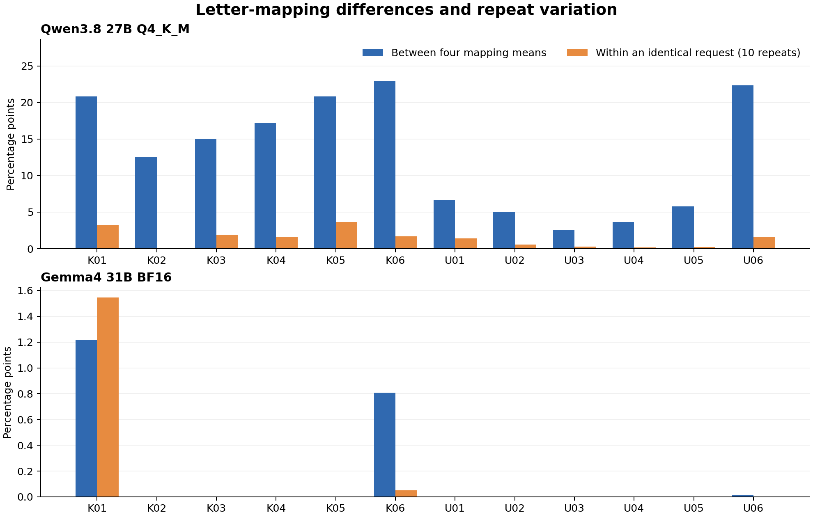
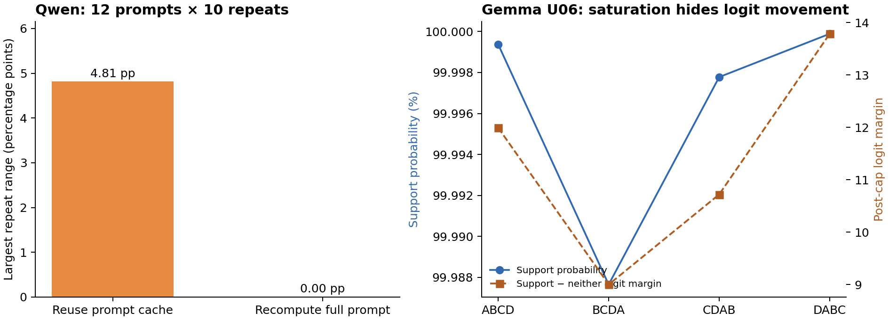

# Native probability repeatability, label mapping and Gemma logits

**Executed November 23, 2026.** Same twelve real source reviews/target segments as the preceding [calm probability pilot](../stage1a_calm_probability_12_2026-11-23/README.md); calm only. These repeated measurements do not add independent review samples. The wider project remains weakly tied image–text emotion grounding, beyond this pilot.

## Findings

1. **Qwen's letter sensitivity is confirmed in this setup.** The native repetitions separate mapping differences from identical-request variation. A second, cache-disabled control produces exactly repeated four-code log probabilities while retaining large mapping effects, including a changed U06 verdict under CDAB.
2. **Prompt-cache reuse is a practical source of repeat variation here.** In the controlled Qwen backend experiment, full recomputation removed observed repeat variation on all twelve tested prompts. This is a measured property of this workload and binary, not a guarantee of every GPU or future run.
3. **Gemma's saturation is not repaired by undoing its soft-cap.** We captured actual pre-softmax capped logits on the same BF16 GGUF, checked a finite-precision analytic inverse, and evaluated the resulting counterfactual. Removing the cap preserves the winner and sharpens its four-code probability. Smaller visible probability changes do not establish more stable internal preferences.

## 1. Native repeat and mapping experiment

Pinned **Ollama 0.40.17**, RTX PRO 6000 Blackwell Server Edition 96 GB; serial requests and one loaded model. Same original checkpoints: Qwen `qwen3.8:27b` Q4_K_M digest `aaee06c39dcf2437cde036998d960e1fc1494b8191be7cc9657d01e509097813`; Gemma `gemma4:31b-it-bf16` digest `df1661a2a6aaa94faf24bbaf23a691877a27d0e6052598f105a225618a079e76`. Digests verified before calls. Native backend defaults include enabled MTP; this study does not ablate MTP.

Four evidence states, in fixed semantic order: neither, support only, opposition only, both. Assign codes **ABCD, BCDA, CDAB, DABC**. Question wording, definitions, review context, target and semantic option order stay fixed. The first two payloads match the previous pilot hashes exactly. These are four cyclic assignments, not all 24 permutations and not a wording test.

Ten shuffled repeat blocks per mapping/case/model, then unload/reload and three more blocks: **624 native readouts per model; 1,248 total**. Temperature 0, seed 42, context 8192, top_k 0, top_p 1, min_p 0, repeat_penalty 1, think false, one decision token, top twenty native alternatives. Debug-render requests are excluded from the readout count.

Here, q is native probability renormalized over the four exact single-letter codes. A change of 0.01 in q is one percentage point. For each review we compare the largest state-probability spread between four mapping means with the largest within-payload repeat range. Bounds retain omitted alternatives; omitted candidates are never treated as zero. Metrics are descriptive development diagnostics, not significance tests.

**Raw-field note:** the frozen helper's legacy `marginal_probability_intervals` and `max_state_interval_width` fields remain in raw measurement objects for auditability. They use an older rounded-residual bound and are not authoritative. This run recomputed `state_probability_intervals` from the top-k cutoff; every reported result uses those corrected state intervals or native log probabilities. Recompute any support/opposition marginal bounds using the same cutoff before downstream use.

| Model | Largest identical-request range, main (pp) | Largest mapping-mean spread, main (pp) | Cases mapping spread exceeds observed repeat range | Cases with different mapping winners | Largest mean shift after reload, same payload (pp) |
|---|---:|---:|---:|---:|---:|
| qwen3.8:27b | 3.6623 | 22.9341 | 12/12 | 1/12 | 2.6922 |
| gemma4:31b-it-bf16 | 1.5464 | 1.2149 | 7/12 | 0/12 | 0.2278 |

Both models had zero within-payload verdict-flip groups in the **native** main/reload blocks. This differs from cross-mapping changes and from the separate cached backend control below. Full phase-specific results, including the three-repeat reload phase, are in [analysis_summary.json](analysis_summary.json) and [comparison.csv](comparison.csv).



Gemma supplied complete four-code readouts in **195/624** calls. Its chosen-state lower probability bound was at least 99.9% in **533/624** calls. Available native log-probability differences preserve relative post-cap logit margins even when the top probability rounds close to one. The largest observed within-payload range of an available pairwise margin was **1.760469**. Do not compare raw logit scales across model families as a calibrated confidence scale.

## 2. Adaptive Qwen cache control

Added after native Qwen variation was observed; documented separately in [CACHE_SUPPLEMENT.md](CACHE_SUPPLEMENT.md). K01, K06 and U06 × four mappings × ten repeats × cache on/off = **240 additional calls**. Same bundled llama-server executable, GGUF and server-rendered prompts. The direct `/completion` request differs only in `cache_prompt`; mode order is interleaved. Logged token counts verify that the cold condition reused zero prefix tokens.

| Condition | Largest identical-request range (pp) | Prompts with verdict flips across repeats | Prompts with identical four-code log probabilities | Median request time | Actual reused-prefix token range |
|---|---:|---:|---:|---:|---|
| warm | 4.8139 | 2/12 | 0/12 | 0.500 s | [1486, 2556] |
| cold | 0.0000 | 0/12 | 12/12 | 0.892 s | [0, 0] |

These twelve prompts are three reviews under four mappings. Median timing excludes model loading. The direct cached control and public API are separate routes: the largest difference between their mapping/case mean probabilities was **4.6614 pp**, so the cached endpoint should not be described as numerically interchangeable with native `/api/chat` in every call. The causal cache comparison is within the direct endpoint, where the request factor is controlled.

Full recomputation does **not** remove the letter effect:

| Case | Cold-cache mapping spread (pp) | Verdicts by rotation 0–3 |
|---|---:|---|
| K01 | 19.9619 | 0: neither; 1: neither; 2: neither; 3: neither |
| K06 | 22.9334 | 0: opposition_only; 1: opposition_only; 2: opposition_only; 3: opposition_only |
| U06 | 24.7819 | 0: support_only; 1: support_only; 2: neither; 3: support_only |

Ollama 0.40.17's [completion implementation](https://github.com/ollama/ollama/blob/v0.40.17/llm/llama_server.go) hardcodes `cache_prompt: true`; its public [options type](https://github.com/ollama/ollama/blob/v0.40.17/api/types.go) does not expose that switch. The tested route is the private bundled backend with explicit `cache_prompt=false`, requiring a scoring adapter or server change for normal pipeline use. No production pipeline code was changed here.



## 3. Gemma direct logits and inverse calculation

Separate backend: **llama-cpp-python 0.3.25**, the identical BF16 GGUF layer, actual Ollama-rendered prompt strings. Forty-eight case/mapping inputs plus sixteen repeated full recomputations on K01, K06, U03 and U06 = **64 direct forward passes**. Context/cache cleared each time; n_ctx 8192, n_batch/n_ubatch 512, all GPU layers, flash attention false. Token IDs and runtime metadata are retained. This is a backend condition, not an unrecorded substitution for native Ollama.

The direct backend agreed with native main-phase chosen states in **64/64** comparisons; the largest four-code probability difference against a native mapping/case mean was **0.398754 pp**. All rendered-prompt hashes were verified; input token counts matched native counts in **64/64** comparisons. The full-vocabulary winning token was one of the four codes in **64/64** passes. Repeated direct passes had maximum absolute code-logit difference **0**. See [native_alignment.json](direct_gemma/native_alignment.json).

The GGUF metadata verifies `gemma4.final_logit_softcapping = 30`. With pre-cap value u, capped pre-softmax score s and c=30:

```math
s = c \tanh(u/c), \qquad p_i = \frac{\exp(s_i)}{\sum_j \exp(s_j)}.
```

For an actual score strictly inside the cap:

```math
u = c \mathrm{atanh}(s/c).
```

All four code scores were inside the cap in **64/64** passes; the largest forward/inverse round-trip residual was **3.55e-15**. These are analytic reconstructions from finite-precision capped outputs, **not an internal pre-cap tensor hook**. The round-trip check verifies the algebra; it cannot recover precision lost upstream, and the inverse becomes sensitive near the cap. Boundary scores cannot be inverted reliably. Absolute pre-cap scores cannot be recovered uniquely from returned probabilities alone because softmax discards a shared additive offset; available log-probability differences do recover post-cap score differences.

Examples below are original ABCD mapping, first direct pass. The strongest alternative is another one of the four codes, not the whole vocabulary.

| Case | Winner | Original four-code probability | Post-cap winner/runner-up margin | Reconstructed pre-cap margin | Counterfactual probability without cap |
|---|---|---:|---:|---:|---:|
| K01 | opposition_only | 98.7993997910% | 4.415579 | 36.203843 | 100.0000000000% |
| K06 | neither | 99.7924784782% | 6.175625 | 27.605176 | 99.9999999999% |
| U06 | support_only | 99.9996699928% | 12.637078 | 32.990187 | 100.0000000000% |

Removing the cap did not reduce the selected-state probability in **64/64** fully invertible passes. The cap contracts logit differences; undoing it sharpens these choices. Large score separation plus softmax produces the extreme probabilities. This experiment does not isolate which training mechanism produced that separation.

Every direct readout also contains an offline temperature grid T=1,2,4,6,8. A larger scoring temperature can spread the numbers, but no temperature was learned from independent labels here. It is a sensitivity calculation, not calibration. Returned log-probability margins are useful immediately for inspecting hidden variation; they do not by themselves become emotion intensity.

## 4. What to use next

- For probability experiments, freeze full recomputation as the measurement condition and verify it again in the intended scoring adapter. Keep model digests, binary versions, rendering, tokenization and hardware recorded.
- For letter sensitivity, remap and average a fixed balanced set of semantic distributions; retain the spread alongside the mean. Averaging a predefined four-cycle set removes dependence on which of those four is singled out; it does not prove invariance to the other twenty assignments or revised wording. The present experiment measures sensitivity, not downstream benefit from this ensemble.
- For Gemma, preserve log probabilities/logit margins alongside probabilities. Do not undo the soft-cap expecting softer confidence. If calibrated probabilities are needed, fit a scoring temperature on separate annotations and compare hard targets, fixed label smoothing and probability targets on held-out locations.
- Stable confidence can accompany an attribution error. These twelve reused cases do not establish calibration, emotional-intensity measurement, better extraction accuracy or improved image-model training. The original K01 issue remains an interpretation diagnostic; no new adjudication or model selection is claimed.

## Artifacts and reproduction

- [Frozen protocol](PROTOCOL.md), [cache supplement](CACHE_SUPPLEMENT.md), [manifest](manifest.json).
- [The twelve frozen inputs and exact target segments](inputs.jsonl), verified against the manifest's case hash.
- [Native analysis](analysis_summary.json), [case/phase comparison](comparison.csv), [cache analysis](cache_analysis_summary.json).
- [Raw result archive](raw_results_bundle.tar.gz): complete native/cache requests and responses, rendered prompts, logs, source snapshot, 64 direct readouts, token IDs, all code logits and top-twenty scores; full-vocabulary capped vectors additionally for original-map K01/K06/U06. No model weights.
- [Raw archive hash and size](BUNDLE.json), [local verification](archive_integrity.json), [compute cleanup](cleanup.json).
- Scripts: [native runner](repeat_probe.py), [cache control](cold_cache_control.py), [logit capture](direct_logits.py), [native analysis](analyze_repeat.py), [cache analysis](analyze_cache.py), [report](generate_report.py), [packaging](package_results.py), [bootstrap](bootstrap.py).

Extract the archive into this directory. Verify every archived file against `INTEGRITY.json`. The archive preserves the execution-time code; the files alongside it include later report formatting. With `PILOT_ROOT` pointing to its `frozen_source_snapshot`, the exact source bytes are self-contained. Direct-artifact analysis also uses NumPy; plots use Matplotlib:

```bash
python analyze_repeat.py
python analyze_cache.py
python generate_report.py
```

Inference additionally requires the pinned Ollama/model digests and the recorded GPU/backend configuration. The direct backend uses the specified CUDA wheel; a loader-only repair exposes Ollama's bundled NVIDIA libraries without loading its ggml/llama libraries into the Python backend. Native requests were unchanged. An initial source-download check found the already-published target script had one extra terminal newline: recovery removed only that byte and required the original frozen SHA-256 before proceeding. Both setup events and the paused/resumed cache-control insertion are preserved in the archive. No test review was changed.

The owned pod was terminated after approximately **33 minutes**; the wall-clock compute estimate at the observed $2.69/hour rate is **$1.48**, excluding any separate storage/billing adjustments. The account pod list was empty after termination. Results were downloaded and all archive/file hashes verified before deletion; see [cleanup.json](cleanup.json).

The [preceding research discussion](../../Discussions/model-probability-stability-and-logits-2026-11-23.md) links the primary literature on label bias, probability repeatability, cache/batch effects and logits. This report adds direct measurements for our checkpoints.
