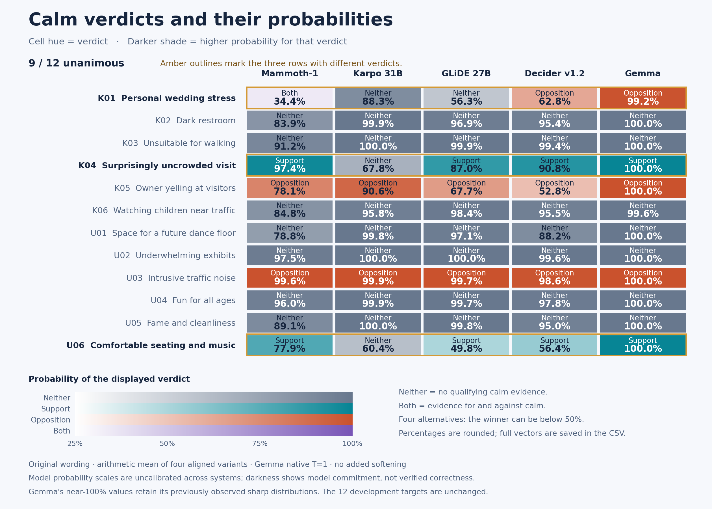
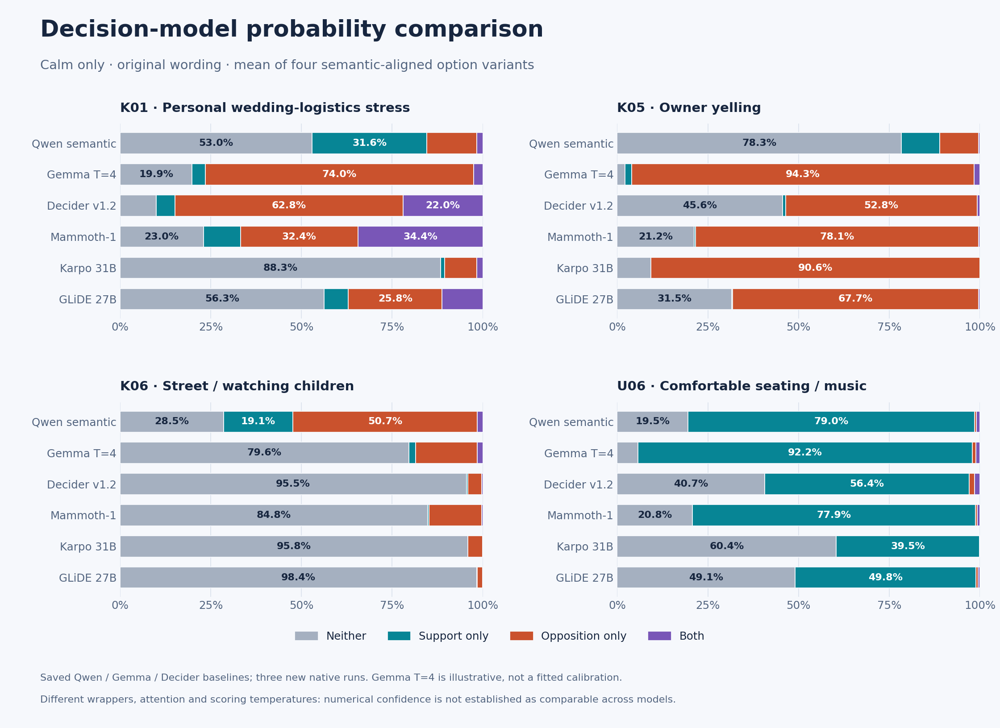
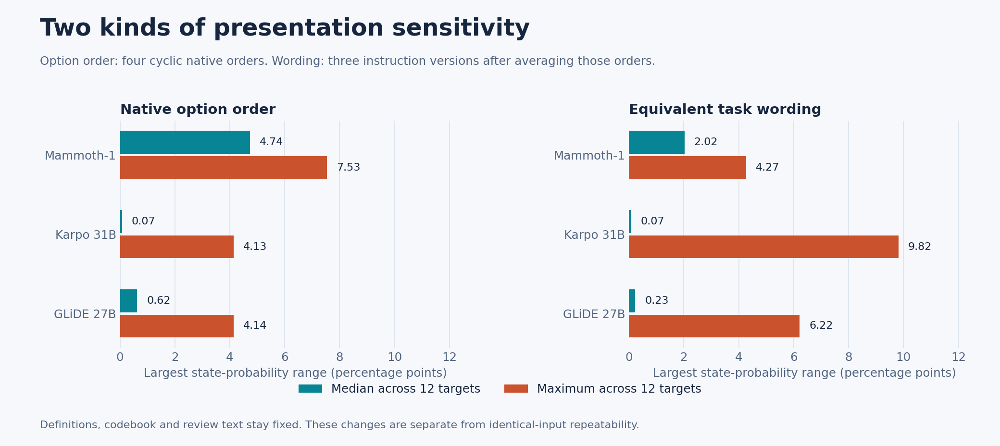

# Mammoth-1, Karpo and GLiDE: executed calm probability comparison

Completed November 24, 2026. **All three models ran successfully through their native implementations**, without Ollama, on the same twelve real target segments and v0.5 codebook used for the earlier Qwen, Gemma and PPLX-Decider experiments. Calm is the only measured emotion.

**Temporary candidate decision, November 24:** retain all five graph models: Mammoth-1, Karpo 31B, GLiDE 27B, PPLX-Decider v1.2 and Gemma4 31B BF16. The earlier preference for only Karpo/GLiDE and firm last-place judgment for Mammoth are superseded by this open candidate set. The [temporary probability wrap and embedding handoff](../../Discussions/three-native-decision-models-probability-comparison-2026-11-24.md#temporary-probability-wrap-for-november-24-2026) records the full discussion. This report's measurements, charts and raw evidence are unchanged; no winner, calibration or probability training weight is adopted.

This is an assistant assessment of a twelve-target development study. No production model, training target, calibrated temperature or confidence-weighting rule is adopted.

## Graphics

### Verdicts across all five models

[Open the shaded verdict chart at full size](five_model_verdict_probabilities.png) · [Vector graphic](five_model_verdict_probabilities.svg) · [Complete probabilities and winner margins](five_model_verdict_probabilities.csv) · [Target segments and categorical verdicts](five_model_verdict_comparison.csv).

Color hue identifies the verdict; darker shades indicate a larger probability for that displayed state. Each cell also prints the winning probability. The color ramp mixes white at 25% with the verdict color at 100%; this is a visualization mapping only. The underlying saved probabilities are unchanged. Four alternatives mean a winning state may have less than 50% probability. The CSV retains all four states plus the runner-up and winning margin.

Gemma keeps its original native T=1 values, explaining its nearly saturated cells. All probabilities are arithmetic means of four aligned original-wording vectors. Cross-model probability scales have not been calibrated; shading displays each model's commitment among the four states, not measured correctness or emotion intensity. The earlier [categorical chart](five_model_verdict_comparison.png) remains available.

All five models agree on **9 of 12** targets. Gemma and Decider agree on **12 of 12**. Karpo returns neither on the two inferred positives (uncrowding and comfortable seating/music), while the other four return support. For personal wedding stress, Mammoth returns both, Karpo and GLiDE return neither, and Decider and Gemma return opposition.

Each cell takes the highest-probability state after the arithmetic mean of four semantically aligned, original-wording vectors. Gemma uses the saved T=1 mapping mean; its T=4 mapping mean gives the same twelve verdicts. New models and Decider jointly vary criterion order and native codes; Gemma varies letter assignment at fixed definition order. These are saved-system comparisons, not a common controlled order manipulation or an accuracy ranking. Original-wording presentation flips for Mammoth K01 and GLiDE U06 are hidden by a single aggregate cell; the full distributions and sensitivity results remain below.

### Probability distributions

Original-wording profiles for four audited cases, including saved Qwen, Gemma and Decider baselines. Labels are rounded to one decimal; complete vectors are retained in the CSVs.

[Open the probability chart at full size](four_case_probability_comparison.png).

### Order and wording sensitivity

Median and worst state-probability shifts across twelve targets. The wording panel uses four-order mean vectors. Identical-input repeat variation was zero for all three models.

[Open the sensitivity chart at full size](order_and_wording_sensitivity.png).

## What was actually done

| Component | Per model | Three models |
|---|---:|---:|
| Original wording: 12 targets × 4 native cyclic option orders × 10 repeats | 480 | 1,440 |
| Two equivalent task-instruction wordings × 12 targets × 4 orders × 3 repeats | 288 | 864 |
| Original canonical requests after unload/reload | 12 | 36 |
| **Completed planned decisions** | **780** | **2,340** |

The codebook, target text, review context and criterion definitions stay fixed. The extra variants paraphrase only the task explanation. Original-wording requests match the saved Decider request objects exactly. Four cyclic orders jointly change option positions and internal answer codes; this is not an isolated letter-only test or all 24 permutations.

The states are **neither / support only / opposition only / both**. Neither means no qualifying calm evidence, not an "I don't know" response or proof of neutral atmosphere. Both requires evidence in both directions. No abstention option was added to exploit Mammoth's published abstention behavior.

There are still only twelve source targets. Repeats and variants are not independent review samples. The separate relevance gate was not rerun; intentionally difficult and potentially gate-ineligible material is retained for continuity. See [METHOD.md](METHOD.md) and the frozen [PROTOCOL.json](PROTOCOL.json).

## Native execution and score access

| Model | Frozen checkpoint | Actual route |
|---|---|---|
| Mammoth-1 | `baselabs/mammoth-1@858aab610d4d124315ebf72d2f36c5e7341f758f` | Author-patched OneJev; fresh native prefix per request, sequential suffix; BF16 model and FP32 LM readout |
| Karpo 31B | `MachinePulseAI/karpo-decision-31B@b8e6fd7463cea8662c556d6257955d7ef9c10d19` | Native `karpo-decision` at `c52d3507a254d3ad8423726c6bc6568c99113e7d`; BF16 backbone and FP32 readout |
| GLiDE 27B | `fastino/GLiDE-27B@061c7d4312670f98261c007f5fd24851a64124dc` | Native checkpoint package; BF16; published two-pass middle-layer recurrence retained |

Each model uses its supplied **T=1** scoring configuration, with no fitted or visually selected softening. Mammoth uses the published torch 2.8/CUDA 12.8 environment and inference constraints; Karpo/GLiDE use torch 2.14 and transformers 5.17. Actual package versions and token counts are in each `results/<model>/runtime.json`. All 22 weight files matched their Hugging Face LFS SHA-256 values. Requests fit without truncation; no question splitting was needed.

Every decision retains all four pre-temperature native option scores and probabilities from the same model evaluation. These are complete native systems with different attention, templates and readouts. Raw-score scales and fields called `confidence` are not an independent common correctness scale.

**Mammoth formatter correction:** its API rounds each probability to six decimals. The first harness missed that formatting and stopped during its second decision. That attempt, including its one logged record and failure, is preserved. The corrected harness verifies through the official formatter and retains both the rounded native output and the same-forward unrounded normalized softmax; analysis uses the latter. Weights, prompts, temperature and model computation were unchanged. The first successful readout's logits and native probabilities match the retry exactly. See [the recorded amendment](MAMMOTH_FORMATTER_AMENDMENT.json).

The completed schedule used **3,120 top-level model forwards**: Mammoth has native prefix and suffix forwards, while Karpo/GLiDE have one per decision. Including the two initial Mammoth decisions gives **2,342 actual decisions, 2,341 archived decision records and 3,124 top-level forwards**. The completed comparison uses exactly the planned 2,340 records. Full native formatting reproduces saved answers exactly; Karpo's separate offline formatter check covers all 780 records.

## Repeatability

All three models gave **identical raw logits and full-precision probability vectors** across:

- All 48 original-wording conditions, ten repeats each.
- All 96 added-wording conditions, three repeats each.
- All twelve canonical requests after reload.

That is **432 repeated-input condition groups** and **36 reload comparisons** with zero observed score variation and zero repeat-driven verdict changes. This establishes repeatability for the tested serial GPU/software configurations, not every backend, batch size or hardware platform.

## Option order and equivalent wording

All gaps below are **percentage points**. An order gap is the largest range of any one state across four orders for a target; the table summarizes twelve target-level gaps.

| Model | Median order gap | Mean order gap | Worst order gap | Targets with changed order winners |
|---|---:|---:|---:|---:|
| Mammoth-1 | 4.7424 | 4.0794 | 7.5314 | 1 / 12: wedding stress |
| Karpo 31B | **0.0750** | 0.9731 | **4.1345** | 0 / 12 |
| GLiDE 27B | 0.6220 | 1.4829 | 4.1426 | 1 / 12: seating/music |

For wording sensitivity, first average four semantically aligned order vectors for each wording. Then measure the largest state range across the three wording means per target.

| Model | Median wording gap after order averaging | Worst wording gap after order averaging | Targets with changed mean winners | Worst wording gap with order held fixed |
|---|---:|---:|---:|---:|
| Mammoth-1 | 2.0211 | **4.2736** | 1 / 12: wedding stress | 8.7786 |
| Karpo 31B | **0.0714** | 9.8213 | 0 / 12 | **13.5412** |
| GLiDE 27B | 0.2274 | 6.2156 | 0 / 12 | 7.6987 |

The worst and typical cases tell different stories. Karpo's very small median does not mean that every target is insensitive: its seating/music case shifts 9.82 points after order averaging, and 13.54 with order held fixed. One matched order flips under a paraphrase. GLiDE has wording-related flips in two matched orders of the same seating/music target, despite stable order-averaged winners. Mammoth's wedding target changes mean winner between both and opposition; both readings retain the attribution error. In one paraphrase its individual orders produce three different winners.

Small median probability gaps are also partly shaped by concentration on easy neither cases. Lower absolute variation is an observed practical property, not proof of better internal reasoning or calibration.

See the [order and wording sensitivity chart](#order-and-wording-sensitivity) above.

## What the actual probabilities say

The [qualitative audit](QUALITATIVE_AUDIT.md) reads all twelve targets against the original text and codebook. It is a current assistant review with earlier discussion visible, not a blinded benchmark. No inherited reference labels are used to claim accuracy, NLL, Brier performance or calibrated confidence.

| Target | Mammoth-1 | Karpo 31B | GLiDE 27B |
|---|---|---|---|
| Personal wedding-logistics stress | Both 34.45%, opposition 32.36%, neither 23.00% | **Neither 88.33%**, opposition 8.91% | **Neither 56.28%**, opposition 25.79%, both 11.26% |
| Surprisingly uncrowded visit | Support 97.45%, neither 2.20% | **Neither 67.79%**, support 32.11% | Support 87.01%, neither 12.43% |
| Owner yelling toward visitors | Opposition 78.08%, neither 21.25% | Opposition 90.61%, neither 9.32% | Opposition 67.75%, neither 31.54% |
| Watching children near an open street boundary | Neither 84.83%, opposition 14.51% | Neither 95.83%, opposition 4.10% | Neither 98.35%, opposition 1.51% |
| Comfortable seating, fairy lights and music | Support 77.91%, neither 20.79% | **Neither 60.41%**, support 39.51% | **Support 49.83%, neither 49.05%** |

Values are original-wording arithmetic means across four aligned orders; remaining state mass is retained in the CSVs and raw results.

**Attribution:** Karpo and GLiDE prefer the appropriate neither reading of the known wedding-logistics case. Mammoth puts 66.81% on states containing opposition and keeps only 23.00% on neither. Its broader distribution therefore does not repair the interpretation. GLiDE also retains 37.05% on states containing opposition, so its correct winner is not proof that the complete soft target is reliable. This review can fail the separate gate; correcting it does not establish a gain on gate-eligible production data.

**Indirect evidence:** Karpo rejects the two plausible positive T inferences as its winning verdict, unlike Gemma, Decider, Mammoth and GLiDE. Its alternative support mass remains substantial. That can represent useful caution, but it may also discard evidence the project intends to retain. GLiDE's seating/music vector is effectively tied; the small winning margin should not be presented as a confident positive label.

**Clear exclusions:** all three prefer neither on the six targets about darkness/maintenance, walking suitability, future dance-floor use, exhibit quality, general fun and fame/cleanliness. All three strongly prefer opposition on explicitly intrusive traffic noise. This does not estimate broad emotion recall: the set has no unambiguous explicitly worded positive-calm control, and its two positive examples depend on T inference.

See the [probability comparison chart](#probability-distributions) above.

## Against Qwen, Gemma and Decider

| Saved baseline | Earlier presentation factor | Median / maximum gap | New model verdict agreements |
|---|---|---|---|
| Qwen semantic answers | Definition order | 6.29 / 39.94 pp | Mammoth 9/12; Karpo 8/12; GLiDE 10/12 |
| Gemma T=4 | Letter assignments, definition order fixed | 1.58 / 14.20 pp | Mammoth 11/12; Karpo 9/12; GLiDE 11/12 |
| PPLX-Decider v1.2 | Native option order/code assignments | 1.07 / 6.90 pp | Mammoth 11/12; Karpo 9/12; GLiDE 11/12 |

These are descriptive comparisons of saved configurations. No baseline was rerun, and they have no matched new wording study. Gemma T=4 is an illustrative offline softening, not a fitted calibration. Qwen's controlled recomputation and Gemma's direct-backend controls were also repeatable; the new result does not establish that only decision models can be reproduced. Different checkpoints, precision, templates, attention and temperatures prevent an architecture-only ranking.

Compared with Decider, GLiDE changes the wedding target to neither and retains the other eleven primary mean verdicts. Karpo changes wedding stress, uncrowding and seating/music to neither. Mammoth changes wedding stress from opposition to both. Agreement itself is not correctness.

## Assessment and next decision

**Updated researcher decision: keep all five graph models as candidates and pause this side study before moving to embeddings.** This supersedes the earlier two-finalist shortlist. These are measured tradeoffs, not a final ranking:

- **Mammoth-1:** exact controlled repeats and both plausible positive T readings retained. Its larger typical native order gap and wedding-stress attribution error remain concerns. Its worst wording gap after four-order averaging, 4.27 pp, was smaller than Karpo's 9.82 and GLiDE's 6.22. A firm last-place judgment was premature.
- **Karpo 31B:** strict evidence acceptance, low typical order sensitivity and cleaner personal-stress attribution. Returning neither for the two plausible positive T inferences and its seating/music wording sensitivity remain concerns.
- **GLiDE 27B:** retains the positive T readings and improves the personal-stress winning interpretation. Seating/music is essentially tied, and some presentations change its verdict.
- **PPLX-Decider v1.2:** retain the exactly repeatable native probability reader and accessible raw scores. Its twelve aggregate verdicts match Gemma, including the attribution error; the new matched paraphrase study did not cover it.
- **Gemma4 31B BF16:** retain the interpretation baseline and controlled direct-backend repeat evidence. Native T=1 saturation, revealed softening/mapping sensitivity and the personal-stress error remain unresolved.

No production model, scoring temperature, evidence-weighting rule or downstream soft-target benefit is established. These twelve development targets lack an unambiguous explicitly worded positive-calm control. See the [consolidated temporary wrap](../../Discussions/three-native-decision-models-probability-comparison-2026-11-24.md#temporary-probability-wrap-for-november-24-2026) for the prior Qwen/Gemma tests, audit corrections, mean/median distinction, existing graph interpretation and agreed embedding/NLI handoff. No new inference or chart regeneration was needed for this update.

## Preservation, cost and reproduction

The owned GPU pod was **terminated**, and the fresh post-termination list was empty. Estimated compute was **$1.89** at the observed **$2.69/hour**, approximately 42.25 minutes including setup, download, the formatter correction, inference and preservation. This is a compute estimate, not an invoice; extra provider storage charges are excluded. See [cleanup.json](cleanup.json).

The immutable [raw_results_bundle.tar.xz](raw_results_bundle.tar.xz) contains **165 manifest-listed files**, plus `INTEGRITY.json`: all completed readouts, the preserved initial attempt, actual rendered inputs/token IDs, original executed code, licensed runtime source, weight integrity records and logs. Its SHA-256 is **`949cd80b48810944a90f4507c5a212cfdce34998c594f87aa363ce65fdb31bd5`**. All files and all 2,340 planned records were verified before termination. Model weights are not duplicated in the archive; their exact public revisions and SHA-256 checks are retained.

The larger `requests.jsonl`, `results/<model>/readouts.jsonl`, `rendered_requests.json`, vendor source and original logs are inside that archive. Extract it into this folder to use them. The codebook, twelve original inputs, three instruction wordings, CSVs and per-model summaries are available directly alongside the report.

For offline analysis, run `python analyze.py` and `python plot_results.py` with NumPy and Matplotlib installed. `bootstrap.py` and `run_model.py` preserve the original installation/execution path, including the logged initial Mammoth check failure; the completed Mammoth run uses `run_mammoth.py mammoth` in its separate environment. Reproduction needs the supplied native sources/checkpoint pins, the `/workspace` layout or corresponding path adjustments, a valid `LEASE.json` budget window, and clean output directories because readout files are append-only. No new GPU resource is required to inspect or reproduce the saved analysis.

## Primary implementation sources

- [Mammoth pinned model card and setup](https://huggingface.co/baselabs/mammoth-1/tree/858aab610d4d124315ebf72d2f36c5e7341f758f); [pinned OneJev source](https://github.com/OmniJev/OneJev/tree/81ce62f1597c91e46767d4d02d6ac2e18534fe94). The checkpoint's author patch is retained.
- [Karpo pinned checkpoint](https://huggingface.co/MachinePulseAI/karpo-decision-31B/tree/b8e6fd7463cea8662c556d6257955d7ef9c10d19); [pinned inference source](https://github.com/machinepulse-ai/karpo-decision/tree/c52d3507a254d3ad8423726c6bc6568c99113e7d).
- [GLiDE pinned checkpoint, decision configuration and runtime](https://huggingface.co/fastino/GLiDE-27B/tree/061c7d4312670f98261c007f5fd24851a64124dc).
- [Earlier Decider experiment](../stage1a_pplx_decider_12_2026-11-24/README.md); [Qwen formats and Gemma softening](../stage1a_probability_formats_12_2026-11-23/README.md).
